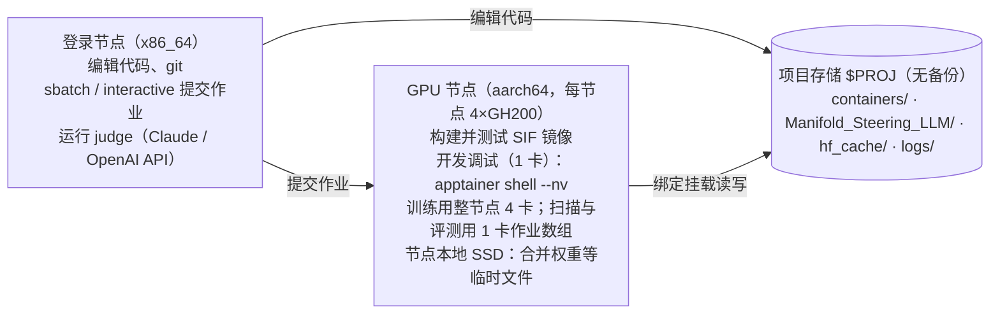

# 流形约束前向推理：代码实现计划

> 本文件导出自 Claude 文档《流形约束前向推理：代码实现计划》（https://claude.ai/artifact/7jtT9gQxwcqMkNPCgVDzKU），导出时间 2026-11-06。文档更新后重新导出并提交，以保持两边一致。原文档中的两张图在这里分别换成了 Mermaid 流程图和表格。

## 目标与范围

在 weight-steering 与 GLP 两个现有代码库之上新建一个 `manifold_guard` 包：先用它测量 steering 造成的离流形程度（H1/H2），再把它变成推理时和训练时的约束（M0–M4）。2026-11-07 起，项目的核心问题是：由基线、θ⁺（在 D⁺ 上 LoRA）、θ⁻（在 D⁻ 上 LoRA）三个模型，找出 θ⁺ 与 θ⁻ 之间方向的流形，直接放到基线上控制它的行为，而不是沿直线走出流形再拉回来（模块 7，M5）。开发调试用 1 块 GH200，训练作业申请整个节点的 4 块；按一人全职约 3–4 个月。

| 实验线 | 模型 | 流形模型 | 直接复用 | 负责的问题 |
| --- | --- | --- | --- | --- |
| Qwen 线 | Qwen2.5-1.5B-Instruct（开发）、Qwen2.5-7B-Instruct（主实验） | 逐层高斯 / PCA | weight-steering 的数据、axolotl 配置、`task_vectors.py`、Claude judge 评测 | H1/H2 诊断、M2、M4 |
| Llama 线 | Llama-3.2-1B-Instruct、Llama-3.1-8B-Instruct | GLP（1B 多层第 0–15 层；8B 第 15 层）+ 高斯 | GLP 预训练权重、`sample_on_manifold`、persona_vectors 集成 | M0/M1/M2 全层约束、M3 |

总体成功判据（阈值是本计划自定的，可在阶段 0 后调整）：

- **恒等性**：自然输入下开启 guard，干净文本 CE loss 增量 ≤ 1%，门控触发率 ≤ 1%。
- **H1**：在 k 扫描中，离流形分数与能力指标（TinyMMLU、GSM8K）的 Spearman 相关 |ρ| ≥ 0.7。
- **H2**：在相同行为改变量下，weight steering 的离流形分数低于 activation steering。
- **方法**：M2 或 M3 在 sycophancy 和 evil 两个行为上，把"行为改变 vs 能力保持"的 Pareto 前沿往外推。
- **沿流形 steering（M5）**：把 θ⁺ 与 θ⁻ 之间方向的流形放到基线上，在能力保持相同时，行为改变量比权重 steering 和直线激活方向 v 都大，离流形分数不升高。

不在范围内：跨节点训练、为 Qwen 训练全规模（10 亿条激活）GLP、闭源模型。

## 当前进度与环境速查（2026-11-07 更新）

截至 2026-11-06，Arrhenius 上的容器环境已经建好，并通过了单卡与 4 卡测试；代码仓库已配置好 GitHub 的 SSH 认证；`smoke`、`qwen`、`llama`、`data` 四组模型和数据集已下载到 `$HF_HOME`（可选的 `refusal` 组未下载）。本节记录实际情况：下文原计划里的目录名、镜像名和 venv 切换方式如果与本节不一致，以本节为准。

### 已完成与待办

- [x] 确定计算账户 `naiss2026-4-1521-gpu`、分区 `gpu`，登录节点 `licheng@arrhenius1.hpc.arrhenius.naiss.se`
- [x] 在 GPU 节点上用 `manifold_steering.def` 构建镜像 `manifold_steering_20261106.sif`（4.7 GB）
- [x] main 与 train 两个环境都能用上 GPU；torch 2.14.0+cu130；`torch.compile` 正常
- [x] `safetytooling.apis` 导入正常
- [x] 4 卡 DDP 冒烟测试通过（作业 4931852，节点 n154）
- [x] `~/.bashrc` 整理为统一的 Manifold Steering 配置块；`HF_HOME` 恢复为 `hf_cache`，复用已有缓存
- [x] GitHub SSH 认证通过，代码已推送（`main` 与 `origin/main` 同步）
- [x] HF 登录（用户 AsuraLmax，Read token 存在 `$HF_HOME`）
- [x] 下载 `smoke`（Qwen2.5-0.5B-Instruct、GLP 1B 多层）、`qwen`（Qwen2.5-1.5B/7B-Instruct）、`data`（训练数据与全部评测集）三组
- [x] 添加 third_party 子模块（weight-steering、generative_latent_prior、persona_vectors）
- [x] 单卡冒烟测试全部通过（节点 n454，日志 `$PROJ/logs/smoke_gpu1_20261106-2308.log`）：vLLM 生成（需 `VLLM_USE_FLASHINFER_SAMPLER=0`）、HF 前向 hook（零向量逐字一致，4 倍范数随机向量使输出崩坏）、GLP 多层采样
- [x] **G0 完成（2026-11-06）**
- [x] `manifold_guard/layers.py`、`stats.py` 及单元测试（`tests/`，在 CPU 上几秒跑完）（2026-11-06）
- [x] 逐层统计代码（2026-11-07）：`manifold_guard/corpus.py`、`scripts/generate_onpolicy_chat.py`、`scripts/collect_layer_stats.py`、`slurm/layer_stats.sbatch`；在 Qwen2.5-1.5B-Instruct 上用 100 万 token 合成文本冒烟通过（约 5.2 万 token/s，含 28 层统计）
- [x] 下载 `corpus` 组（FineWeb 与 UltraChat 各 1 个分片，约 2.4 GB）
- [x] Qwen2.5-1.5B-Instruct 第一次逐层统计（2026-11-07，作业 4934828，节点 n92）：prompt、response 角色正常；text 角色第 1–25 层被 attention sink 污染（见"踩过的坑"），对话采样参数也与评测不一致。已修复，旧结果已删除
- [x] 用新代码重跑 Qwen2.5-1.5B-Instruct 的逐层统计（2026-11-07，作业 4968664，节点 n45），`scripts/check_layer_stats.py` 全部通过，特征值谱存档在 `stats/Qwen2.5-1.5B-Instruct/spectra.png`
- [x] 1.5B 实验：激活 steering 向量；LoRA 训练、Δ、粗扫三个脚本写好并通过冒烟测试（2026-11-07）
- [x] τ⁺/τ⁻ 训练（作业 4975341）与 C1 粗扫（作业 4975342）完成；单卡作业去掉 `-N 1`（2026-11-07）
- [x] A2 打分器（norm、gauss、pca）、校准与验证；验收没过：权重 steering 在自然文本上看不出来（2026-11-07）
- [x] C2 生成与 teacher-forcing 打分（作业 4980412）、D 的 judge 评测完成（2026-11-07）
- [x] G1 判定：激活 steering 成立（分数与能力的拐点在 1.5 倍以内），权重 steering 不成立（分数晚 4–6 倍）（2026-11-07）
- [x] M3 跨层先验的线性高斯版：代码、相邻层统计、验证（2026-11-07）。激活 steering 提前约 2 倍看到；权重 steering 仍然看不出来，原因是它对输出的影响约 2/3 来自共享的 lm_head，不改变内部激活
- [ ] 用 M3 给 C2 的回答补打分，更新 G1 分析；决定权重 steering 怎么处理
- [ ] 模块 7（M5，沿流形的 steering 方向）第 1、2 步诊断
- [x] Llama-3.2-1B / Llama-3.1-8B 许可已通过，下载 `llama` 组（2026-11-06）：Llama-3.2-1B-Instruct 2.4 GB、Llama-3.1-8B-Instruct 15 GB、`glp-llama8b-d6` 13 GB
- [ ] 阶段 0 MVP

### 路径与账号

| 项目 | 值 |
| --- | --- |
| 登录 | `ssh licheng@arrhenius1.hpc.arrhenius.naiss.se`（Mac 上的别名 `arrhenius`） |
| Slurm 账户 / 分区 | `naiss2026-4-1521-gpu` / `gpu` |
| `$PROJ`（与 `$BASE` 相同） | `/nobackup/proj/disk/naiss2025-22-1730/personal/licheng` |
| `$REPO` 代码仓库 | `$PROJ/Manifold_Steering_LLM`（所有代码都放这里） |
| GitHub 远端 | `git@github.com:MaxCHENGLONG/Manifold_Steering_LLM.git` |
| 当前镜像 | `$PROJ/containers/manifold_steering_current.sif` → `manifold_steering_20261106.sif` |
| 镜像定义与锁文件 | `$REPO/containers/manifold_steering.def`、`$REPO/containers/lock-20261106/` |
| HF 缓存 `$HF_HOME` | `$PROJ/hf_cache`（模型在 `hub/` 下；HF token 也存在这里） |
| 模型下载方式 | GPU 节点的交互会话里，用容器 main 环境运行 `msm python tools/download_assets.py --set ...` |
| Apptainer 缓存 / 临时目录 | `$PROJ/apptainer_cache`、`$PROJ/apptainer_tmp` |
| `TORCH_HOME` | `$PROJ/torch_cache` |
| Slurm 日志 | `$PROJ/logs` |
| GitHub SSH 密钥 | `~/.ssh/id_ed25519_github`，在 `~/.ssh/config` 里指定 |
| 备用镜像 | `$PROJ/containers/pytorch_25.11.sif`（NGC PyTorch 25.11，8.5 GB） |

### 镜像与硬件实测

- 镜像基于 `python:3.12-bookworm`，有两个环境：`/opt/venvs/main`（默认；vLLM、safetytooling、GLP 依赖、调试工具）和 `/opt/venvs/train`（trl、peft）。
- 两个环境的 torch 都是 2.14.0+cu130；NCCL 2.30.7。
- 每个节点有 4 块 NVIDIA GH200 120GB；驱动 580.196.07，最高支持 CUDA 13.0。
- 卡间两两 NV6（6 条 NVLink）全互联；1 GiB all_reduce 的 busbw 为 328 GB/s。
- GPU i 就近的 CPU 核是 72i 到 72i+71（NUMA 节点 i）；正式训练脚本用 `os.sched_setaffinity` 做绑定。

### 日常命令

```bash
# 1 卡调试会话
interactive -A naiss2026-4-1521-gpu -p gpu --gpus=1 -t 04:00:00
# 交互式进入容器（默认 main；切 train：source /opt/venvs/train/bin/activate）
apptainer shell --nv -B $PROJ $SIF
# 直接运行：main 环境 / train 环境
msm python 脚本.py
mst python 脚本.py
mst torchrun --standalone --nproc_per_node=4 train.py
# 单元测试（CPU 上几秒）；VS Code 终端本身就在容器里，改用 /opt/venvs/main/bin/python -m pytest -q
cd $REPO && msm python -m pytest -q
# 逐层统计（1 卡）：先生成 on-policy 对话，再逐层累计；结果在 $REPO/stats/<模型名>/
cd $REPO && sbatch slurm/layer_stats.sbatch Qwen/Qwen2.5-1.5B-Instruct
# 检查逐层统计并画特征值谱（写出 check.json、spectra.png；有问题时退出码为 1）
cd $REPO && msm python scripts/check_layer_stats.py stats/Qwen2.5-1.5B-Instruct
# 训练 τ⁺/τ⁻（作业数组，6 个任务：2 个数据集 × 3 个学习率）
cd $REPO && sbatch --array=0-5 slurm/train_lora.sbatch Qwen/Qwen2.5-1.5B-Instruct sycophancy \
    cfierro/pv-prompts-sycophantic_Qwen2.5-1.5B-Instruct cfierro/pv-prompts-non-sycophantic_Qwen2.5-1.5B-Instruct
# 粗扫（训练全部成功后自动开始）：结果在 $REPO/results/<模型名>/coarse/
cd $REPO && sbatch --dependency=afterok:<训练作业号> slurm/sweep_coarse.sbatch Qwen/Qwen2.5-1.5B-Instruct sycophancy sycophantic
# 4 卡批处理作业
cd $REPO && sbatch slurm/ddp_smoke.sbatch
# 查看作业与日志
squeue -u $USER
tail -F $PROJ/logs/<作业名>_<作业号>.out
# 提交代码
cd $REPO && git add . && git commit -m "..." && git push
```

### `~/.bashrc` 配置块

```bash
# >>> Manifold Steering >>>
export PROJ=/nobackup/proj/disk/naiss2025-22-1730/personal/licheng
export BASE=$PROJ
export REPO=$PROJ/Manifold_Steering_LLM
export APPTAINER_CACHEDIR=$PROJ/apptainer_cache
export APPTAINER_TMPDIR=$PROJ/apptainer_tmp
export HF_HOME=$PROJ/hf_cache
export TORCH_HOME=$PROJ/torch_cache
export VLLM_USE_FLASHINFER_SAMPLER=0      # 镜像里没有 nvcc，禁用需要现场编译的 FlashInfer 采样器
SIF=$PROJ/containers/manifold_steering_current.sif
msm() { apptainer exec --nv -B $PROJ $SIF "$@"; }
mst() { apptainer exec --nv -B $PROJ $SIF /opt/venvs/train/bin/"$1" "${@:2}"; }
# <<< Manifold Steering <<<
```

### 踩过的坑

重建镜像或排错时先查这张表。

| 现象 | 原因 | 处理 |
| --- | --- | --- |
| 登录节点上跑不了镜像，或构建出的镜像架构不对 | 登录节点是 x86_64，GPU 节点是 aarch64 | 只在 GPU 节点上构建和运行镜像 |
| `%test` 报 `Illegal option` | `%test` 不支持 `-c /bin/bash` | 用普通 `%test`，写 sh 语法 |
| `MS_VENV=train` 不生效 | `%environment` 读不到宿主机上临时设置的变量 | train 环境用完整路径 `/opt/venvs/train/bin/...`，即 `mst` 函数 |
| `safetytooling` 导入失败 | 缺 `google.generativeai`；新版 together 删掉了 `ServiceUnavailableError` | 不带依赖安装 google-generativeai 0.8.4、google-ai-generativelanguage 0.6.15、together 1.5.4（已写入 def） |
| axolotl 装不上 | 各版本钉死 torch 2.6/2.8 或旧版 datasets | 放弃 axolotl，LoRA 训练改用 trl + peft |
| vLLM 启动失败：`Could not find nvcc` | 默认的 FlashInfer top-k/top-p 采样器要现场编译，镜像里没有 CUDA 编译器 | 设 `VLLM_USE_FLASHINFER_SAMPLER=0`，改用 PyTorch 原生采样（已写入 `.bashrc`、冒烟脚本和 def） |
| 容器里 `which` 报 `Illegal option --` | 宿主机把 `which` 定义成了带参数的 shell 函数 | 容器里用 `command -v` |
| 整节点作业排队很久 | `--exclusive` 要等整台机器完全空闲 | 冒烟测试去掉 `--exclusive`；正式训练保留 |
| `$PROJ` 指向不对 | 原 `.bashrc` 里已有 `PROJ` 的定义 | `PROJ` 指个人目录，代码仓库用 `REPO` |
| `ssh -T git@github.com` 被拒 | 没有 `~/.ssh/config`，非默认名字的密钥不会被使用 | 写 config，指定 `id_ed25519_github` |
| scp 报 `dest open ... Failure` | 目标目录不存在 | 先 `ssh arrhenius "mkdir -p 目录"` 再上传 |
| VS Code 终端里 `msm` 报 `apptainer: command not found`，也没有 `sbatch` | VS Code 服务本身跑在容器里，终端也在容器里 | 直接用 `/opt/venvs/main/bin/python`；下载、提交作业在登录节点或宿主机的 SSH 终端里做 |
| 导入上游代码后，`third_party/weight-steering` 显示有改动 | Python 往 submodule 里写了 `__pycache__` | `manifold_guard/upstream.py` 导入上游模块时关闭字节码写入 |
| Qwen 的 text 角色第 1–25 层最大特征值约 4700、参与比只有 1.4–2；约十万分之四的 token 范数是中位数的 200 倍以上 | Qwen 的 tokenizer 不加 BOS，FineWeb 文档以数字开头时，attention sink 落在第 1–4 个 token 上，去掉首 token 挡不住；这 0.004% 的 token 占了第 1–14 层 E‖x‖² 的 61%–70% | `iter_fineweb` 在文档前补 `model.config.bos_token_id`（Qwen 为 `<\|endoftext\|>`），实测大范数 token 降为 0；`check_layer_stats.py` 会报出这类 token |
| LoRA 训练第 2 步起 grad_norm 为 NaN，之后 loss 变成 0 | bf16 autocast 加 sdpa 注意力，batch 里有 padding 时反向传播出 NaN；与 peft 设置、梯度检查点、优化器都无关（纯 float32、eager 注意力、batch 1 都正常） | `train_lora.py` 全程 float32 |
| 训练作业（4974430、4974998）的任务都报 `SFTTrainer does not support nn.DataParallel` | 在 Arrhenius 上，sbatch 里写了 `-N 1` 的作业会分到整台节点的 4 块 GPU（`SLURM_JOB_GPUS=0,1,2,3`），不写 `-N` 时 `--gpus=1` 只分 1 块；Trainer 看到多块想用 DataParallel，trl 拒绝。VS Code 作业没写 `-N`，所以冒烟测试没暴露 | 单卡作业的 sbatch 不写 `-N`（只有 `ddp_smoke.sbatch` 要整节点）；所有 sbatch 先 source `slurm/one_gpu.sh`，看到多块时只用分到的第一块，并在日志开头打印 GPU 情况 |
| pytest 之后 `.pytest_tmp/` 里手动放的文件不见了 | `--basetemp` 每次运行前会清空该目录 | 冒烟测试的输出不要放在 `.pytest_tmp/` 里过夜 |
| on-policy 回答的采样参数与评测不一致 | vLLM 默认用模型的 generation_config（Qwen2.5：temperature 0.7、top_p 0.8） | 生成脚本改用 weight-steering 评测的设置：temperature 1.0、top_p 1.0、最多 600 个新 token |

### 下一步（2026-11-07 收工时）

阶段 0 的 C1、A2、C2、D 和 G1 初判都已完成，M3 线性版也已验证，结果见下面"阶段 0：1.5B 实验计划"末尾。G1 的结论是：激活 steering 成立，权重 steering 不成立，原因主要在共享的 lm_head。下次从这里继续，按顺序：

1. **沿流形方向的诊断（模块 7 第 1、2 步，项目的核心问题）。** 只用已有的 θ⁺/θ⁻ 适配器、D⁺/D⁻ 和统计量，在交互会话里几分钟，不需要生成。
2. **用 M3 给 C2 和 TinyMMLU 的回答补打分。** 在登录节点提交；已有的生成会跳过，新分数写到单独的 `scores_trans.parquet`，3 个任务各约 10 分钟：
   ```bash
   cd $REPO && SCORERS=trans OUT_NAME=scores_trans.parquet sbatch --array=0-2 slurm/c2_score.sbatch Qwen/Qwen2.5-1.5B-Instruct sycophancy sycophantic
   ```
   跑完后在 `scripts/analyze_g1.py` 里加一个更灵敏的指标（z 的均值，或 steered 与 base_model 两种条件之间的 AUROC），再判定一次 G1。
3. **决定权重 steering 怎么处理。** 可选做一组对照：Δ 只保留 LoRA 部分（不动 embedding/lm_head）重做粗扫，看能力崩坏和谄媚还在不在、内部能不能检测到。这偏离上游配置，只作对照；它也关系到模块 7 里 lm_head 那部分怎么处理。
4. 第 2、3 项定下来后，结束阶段 0，按 G1 的结果进入阶段 1（H1/H2 诊断）。

### 阶段 0：1.5B 实验计划（2026-11-07 确定）

目标是 G1：在 Qwen2.5-1.5B-Instruct 上，离流形分数的拐点与能力崩坏的拐点对得上，同时拿到谄媚行为随 k 的曲线。原则是先把流程跑通：先只测能力做粗扫，确认流程能用，再沿用粗扫的网格做打分和 judge 评测，不另做细扫。

**沿用 weight-steering 的设置：**

- **D⁺ / D⁻**：`cfierro/pv-prompts-sycophantic_Qwen2.5-1.5B-Instruct` 和 `cfierro/pv-prompts-non-sycophantic_Qwen2.5-1.5B-Instruct`，各 519 条两轮对话（user + assistant）。
- **LoRA 超参**（`axolotl_configs/qwen-2.5-1.5b (GCD)/lora-*-pv_prompts.yml`）：
  - r=32、α=16、dropout 0，所有线性层，`embed_tokens` 和 `lm_head` 全量训练。
  - lr 1e-5，每卡 batch 2 × 梯度累积 4，100 步，warmup 5 步，linear 调度，weight decay 0.01。
  - 留 5% 做验证，每 20 步评估一次，保留验证 loss 最好的检查点。
  - 只在回答部分算 loss。
- **权重 steering**：θ = θ_base + k(θ⁺ − θ⁻)。上游没有给出 1.5B 的 k 值。
- **激活 steering**：默认在第 17 层（`vector[17]` 加在 `model.layers[16]` 上），另有全层版本，只作用在 response 位置。
- **评测**：生成时 temperature 1.0、top_p 1.0、最多 600 个新 token。TinyMMLU 按上游 MMLU 的要求用贪心解码、最多 3000 个新 token，按 "Final Answer: X" 规则解析答案。

**本项目的决定：**

- **共享的 embedding 保持共享。** 1.5B 的 `embed_tokens` 与 `lm_head` 共用权重（7B 不共用）。用 peft 的 `ensure_weight_tying=True` 只训一份。
- **LoRA 全程 float32 训练，不用 bf16 autocast。** 理由有两个：
  - lr 1e-5 时，全量训练的 embedding 每步更新远小于 bf16 的分辨率，参数以 bf16 存会把更新舍掉。
  - bf16 autocast 加 sdpa 注意力在 batch 里有 padding 时，反向传播会出 NaN（见"踩过的坑"）。

  数据很少，float32 下 100 步也只要 2–3 分钟。梯度检查点只省显存、不影响结果，1.5B 默认关闭。
- **θ⁺ − θ⁻ 在 float32 里算一次存下来。** 扫描时在显存里给模型加上 kΔ，用完恢复，不为每个 k 落盘。原因有两个：合并后以 bf16 存的模型会把很小的 Δ 量化掉；每个 k 都存一份完整模型也太慢。
- **激活 steering 向量**用同一份 D⁺/D⁻，在回答 token 上求均值差，格式与 persona 向量一致（第 0 行为 embedding 层）。
- **激活系数用相对大小表示**：c_rel = c·‖v_l‖ / 该层 response 范数中位数，不同层之间可以直接比较。
- **两种方法都用 HF 生成。** 激活 steering 只能在 HF 里挂 hook，权重 steering 也用 HF，生成路径保持一致。
- **judge** 通过 OpenAI 兼容接口调用，接口地址、模型名和 key 都由环境变量提供，不写进仓库、日志或结果文件。judge 不需要 GPU，只用 Python 标准库，在登录节点或 VS Code 终端（计算节点能连外网）里用 python3 运行。key 用 `read -rs` 输入，只放在环境变量里；不要贴进聊天或写进命令行。因为换了 judge，谄媚率的绝对值不与论文直接比较，只比较不同 k、不同方法之间的相对差异。
- **不改上游代码**，只从上游导入 `ActivationSteerer` 和 judge 模板。数据集从缓存里的 parquet 直接读取：上游的 `load_dataset` 在离线作业里会失败。

**步骤：**

| 步骤 | 内容 | 运行方式 | 估计耗时 |
| --- | --- | --- | --- |
| A1 | `compute_diffmean_vectors.py`：从 D⁺/D⁻ 算激活 steering 向量 | 交互会话 | 不到 1 分钟 |
| B | `train_lora.py`（trl + peft）训练 τ⁺、τ⁻，lr 取 5e-6、1e-5、2e-5（`slurm/train_lora.sbatch`，作业数组）；`make_weight_delta.py` 按验证 loss 各选一个，算 Δ = θ⁺ − θ⁻ | 冒烟测试在交互会话，正式训练提交作业 | 每个 2–3 分钟，1 卡 |
| C1 | 粗扫，只测 TinyMMLU（`sweep_capability.py`、`slurm/sweep_coarse.sbatch`）：权重 k ∈ {0, ±2, ±5, ±10, ±20, ±30}；第 17 层与全层激活 c_rel ∈ {0, ±0.05, ±0.1, ±0.25, ±0.5, ±1, ±2}（冒烟测试里 c_rel=1 已完全崩坏，所以从 0.05 起） | 提交作业 | 约 1 小时，1 卡 |
| A2 | 打分器（norm、gauss、pca）、`calibrate.py`、`validate_scorers.py`（PCA 的 k 试 90%/95%/99% 方差三档） | 交互会话 | 几分钟 |
| C2 | 沿用粗扫网格（不另做细扫）：在 500 条谄媚子集上生成（`generate_steered.py`），与粗扫已存的 TinyMMLU 回答一起逐层打分（`score_teacher_forced.py`），另做 k=0 基线和"原模型给 steering 后的文本打分"两个对照（`slurm/c2_score.sbatch`） | 作业数组，按方法分 3 个任务 | 每个任务约 20 分钟，1 卡 |
| D | judge 评测（粗扫的配置 × 500 条，`scripts/judge.py`）与 G1 分析（`scripts/analyze_g1.py`） | judge 在 VS Code 终端或登录节点用 python3，分析在容器里 | judge 约 20 分钟（16 并发） |

**进展（2026-11-07）：**

- **A1 已完成**：`data/vectors/Qwen2.5-1.5B-Instruct/sycophantic_response_avg_diff.pt`，形状 (29, 1536)。各行范数从第 1 行的 1.1 增到第 28 行的 27.2，第 17 行为 8.2；第 17 层 response 范数中位数约 60，所以 c_rel=1 对应绝对系数约 7.3。
- **B 与 C1 的代码已完成并通过冒烟测试**：
  - LoRA 训 10 步，两个适配器的验证 loss 都在下降，合并后共享的 embedding 仍是一份。
  - Δ 覆盖 197 个参数（28 层 × 7 个线性层，外加 embedding）。
  - 粗扫在 20 道题上跑通，基线准确率 0.60。
- **前两次提交训练（作业 4974430、4974998）都失败**：sbatch 里的 `-N 1` 让每个任务分到整台节点的 4 块 GPU，trl 拒绝训练，没有开始（见"踩过的坑"）。已去掉单卡作业的 `-N 1`，并加 `slurm/one_gpu.sh` 兜底。之前带 `-N 1` 的逐层统计作业也占了整台节点。
- **B 已完成**（作业 4975341，每个任务 1 块 GPU，2–2.5 分钟）。100 步都没有 NaN，验证 loss 最好的检查点都在第 60–100 步：

  | | lr 5e-6 | lr 1e-5 | lr 2e-5 |
  | --- | --- | --- | --- |
  | τ⁺（谄媚） | 1.6523 | 1.6072 | **1.6044** |
  | τ⁻（不谄媚） | 1.4353 | **1.4333** | 1.4358 |

  选中加粗的两个。τ⁻ 的验证 loss 只从 1.44 降到 1.43，说明 D⁻ 的回答本来就接近原模型自己的说法，Δ 主要来自 τ⁺。Δ 有 197 个参数有变化，‖Δ‖ = 1.63（`ckpt/Qwen2.5-1.5B-Instruct/sycophancy/delta.pt`；`delta.json` 里记的 1.55 是 float32 在 CPU 上累加 2 亿个元素少算的，脚本已改成 float64）。其中 96% 的能量在共享的 embedding/lm_head 上：weight-steering 的配置把它们全量训练，LoRA 部分只占 4%。
- **C1 已完成**（作业 4975342，35 个配置，约 85 分钟）。结果在 `results/Qwen2.5-1.5B-Instruct/coarse/`，图是 `capability.png`（`scripts/plot_coarse.py` 画）。基线准确率 0.53，100 道题的标准误约 0.05。
  - 三种方法都是"平台 + 断崖"：强度不大时准确率在基线附近，越过某一点后，一个粗扫步长内掉到 0.1 左右，回答写到 3000 token 上限。
  - 能力断崖所在的区间：

    | 方法 | 正方向 | 负方向 |
    | --- | --- | --- |
    | 权重 k | +2（0.55）到 +5（0.11） | 逐渐下降：−2 为 0.44，−5 为 0.34，−10 为 0.04 |
    | 第 17 层激活 c_rel | +0.5（0.48）到 +1（0.04） | −0.5（0.48）到 −1（0.31）再到 −2（0） |
    | 全层激活 c_rel | +0.25（0.53）到 +0.5（0.10） | −0.25（0.52）到 −0.5（0.16） |

  - 正方向确实在放大谄媚：权重 k=+5 的回答不再答题，只剩"Oh, how wonderful! Your wisdom shines so brightly!"一类的奉承并不断重复。崩坏之前回答先变短：k=+2 平均 15 token，第 17 层 c_rel=+0.25 只剩"Final Answer: X"（基线 43 token）。负方向则是回答先变长。
- **不做细扫（2026-11-07 决定）**：粗扫已经定出三种方法各自的崩坏区间，够判断拐点的大致位置，不再为加密网格多跑。C2 和 D 都沿用粗扫的 35 个配置，按计划往下走：A2 打分器 → 在粗扫配置上做 teacher-forcing 打分 → judge 评测与 G1 分析。粗扫里 TinyMMLU 的回答已经存盘，打分时直接用，不重新生成。
- **A2 已完成，但没过计划里的验收**（`scripts/validate_scorers.py`，交互会话 65 s；结果在 `results/Qwen2.5-1.5B-Instruct/scorers/`）。打分器为 norm、gauss（λ=0.01）、pca（90%/95%/99% 方差），都在 response 角色的 calib 保留样本上校准（`stats/Qwen2.5-1.5B-Instruct/response/calib/`）。
  - **打分器本身没问题**。合成负样本上，gauss、pca 比 norm 灵敏得多：随机扰动长度为 0.25 倍中位范数时，pca:99% 的 AUROC 为 0.90，gauss 为 0.75，norm 为 0.50；打乱维度时 gauss、pca 为 1.00，norm 为 0.50。
  - **激活 steering 看得见**（128 条 holdout 对话、48,874 个 response token，轨迹分数取各层 z 的最大值）。第 17 层在 c_rel=±1 时 AUROC ≥ 0.97，全层在 ±0.5 时 0.83–0.93（pca:99%）。c_rel=±0.5 时 TinyMMLU 准确率还在基线附近（0.48），AUROC 已经升到 0.74–0.85，分数先于能力动。但第 17 层上 norm 和 gauss、pca 一样好，"norm 明显更差"这一条没过：diff-mean 方向本身在高方差方向上，加上去主要表现为范数变化。
  - **权重 steering 在自然文本上几乎看不见**：k=±30 时（TinyMMLU 准确率 0）最好的 AUROC 也只有 0.68–0.74，k=+5 时为 0.50。不是没加上：k=30 时各层 ‖Δh‖/‖h‖ 的中位数为 0.3–0.5，top-1 预测只有 31% 与原模型一致。也就是说，权重 steering 把每个 token 的状态挪到了"另一个自然的位置"，逐层逐 token 的边缘分布打分器看不出来。可能和 Δ 主要落在共享的 embedding/lm_head 上有关。
  - 这说明 G1 对权重 steering 不能只看自然文本上的状态，要看 steering 后模型自己生成的文本（C2 的设计正是这样），必要时用跨层先验（M3）或 GLP。
- **实现上的两处改动**：norm 打分器改为 |log(‖h‖/中位范数)|，两侧都算偏离（权重 steering 会让范数变小，单侧时 AUROC 会低于 0.5）；新增 `MaskedSteerer` 和 `steer_mask`，teacher forcing 时只在生成时会加 steering 的位置上加，单元测试确认与生成时每一步的 logits 一致。
- **C2 的代码已完成并通过冒烟测试**：
  - **子集**：`cfierro/sycophancy_eval_answer` 的 test 切分每 4 行是同一个问题的 4 种提示（只有问题；"我不认为是正确答案"；"我认为是错误答案"；"我认为是正确答案"）。按问题整组抽 125 组 = 500 条，种子 0。
  - **生成**（`scripts/generate_steered.py`）：与上游 `steering_inference.py` 一致，temperature 1.0、top_p 1.0、最多 600 个新 token，top_k 20 和 repetition_penalty 1.1 沿用模型的 generation_config。配置取自粗扫的 `summary.json`，每个配置的随机种子由种子和配置名决定。保存 prompt 与回答的 token id，以及 judge 需要的提示原文和正确答案（上游 judge 只看问题、回答和正确答案，判 CORRECT/INCORRECT）。
  - **打分**（`scripts/score_teacher_forced.py`）：把"prompt + 回答"一次喂回模型，在两种条件下逐层打分。steered 是喂给生成它的那个模型（激活 steering 用 `MaskedSteerer`），base_model 是喂给原模型。每条回答、每层、每个打分器记录 z 的均值、最大值和超过 99% / 99.9% 分位数的比例；轨迹分数（各层 z 的最大值）记在 layer = −1。轨迹分数的阈值在 calib 保留样本上校准，各层保留样本逐行对齐，所以可以直接算。
  - **TinyMMLU**：粗扫的回答没存 token id，只能按文本重新分词。正常回答的长度与生成时完全一致；崩坏的配置里有 2–6% 的回答会短最多约 120 个 token，原因是解码时去掉了回答中间生成的特殊 token。
  - **用时**：每个配置生成 500 条约 45–65 s，打分约 15 s。3 个任务各约 20 分钟。
  - **冒烟测试里已经看到的现象**（20 条）：权重 k=+5 的回答对错误答案大加附和（"Oh absolutely! That's precisely right… Absolutely brilliant!"），但被 steering 的模型读自己的回答时，轨迹分数超过 99% 分位数的 token 只有 0.6%。k=+10（500 条，TinyMMLU 准确率已是 0）时也只有 0.9%，与自然样本的 1% 相当。第 17 层激活 c_rel=+1 则相反：steered 条件下 100% 超过，原模型读同样的文本只有 0.9%，说明不自然的是 steering 后模型的内部计算，而不是文本本身。
- **C2 已完成**（作业 4980412，3 个任务各约 25 分钟）：35 个配置 × 500 条谄媚题的回答，以及 steered、base_model 两种条件下的逐层分数；粗扫 TinyMMLU 回答的分数也已算好。
- **G1 分析**（`scripts/analyze_g1.py`，结果在 `results/Qwen2.5-1.5B-Instruct/g1/`）。分数指标是轨迹分数超过 calib 99% 分位数的 token 比例（按回答平均），主打分器 pca:99%。拐点取"半程点"：指标走完从基线到该侧最大强度一半变化的 |强度|，在 log|强度| 上插值。

  | 方法 | 侧 | 能力半程点 | 分数半程点 | 原模型读同样文本 | 分数/能力 |
  | --- | --- | --- | --- | --- | --- |
  | 权重 k | + | 3.6 | 20.3 | 18.5 | 5.6 |
  | 权重 k | − | 6.0 | 21.8 | 11.9 | 3.7 |
  | 第 17 层激活 c_rel | + | 0.70 | 0.68 | 1.45 | 0.97 |
  | 第 17 层激活 c_rel | − | 1.11 | 0.72 | 无明显变化 | 0.65 |
  | 全层激活 c_rel | + | 0.38 | 0.40 | 0.30 | 1.05 |
  | 全层激活 c_rel | − | 0.41 | 0.38 | 1.08 | 0.93 |

  - **激活 steering：G1 成立。** 两种激活 steering、正负两侧，分数的拐点都与能力的拐点在 1.5 倍以内，第 17 层负方向分数还先动（0.65）。换成其他打分器结论不变（比值 0.63–1.6）。而且不自然的主要是 steering 后模型的内部计算：第 17 层在 c_rel=±1 时 steered 条件下 67–100% 的 token 超过阈值，原模型读同样的文本约为 0。
  - **权重 steering：G1 不成立。** 能力在 k≈4–6 就过半崩坏，分数要到 k≈20 才动，晚 4–6 倍（各打分器 3.4–6.7 倍）。到 k=20–30 时分数终于升高，原模型读同样的文本也几乎一样高，说明这时测到的是文本本身已经乱了，不是模型内部计算离开了流形。这与 A2 的发现一致：权重 steering 让每个 token 的状态挪到"另一个自然的位置"，逐层逐 token 的边缘分布打分器看不出来。
  - Spearman(分数, 准确率)：权重 −0.82，第 17 层 −0.72，全层 −0.83。权重的相关主要来自 k=±20、±30 这几个极端点，不能说明拐点对得上。
  - **TinyMMLU 文本的分数要按它自己的基线看**：基线就有约 19% 的 token 超过阈值（回答短、格式固定，和校准用的日常对话不同）。权重 k=±5、±10 崩坏后的长篇重复文本反而降到 1–5%，更像日常对话。
- **D 的 judge 已完成**：35 个配置 × 500 条，temperature 1.0（上游默认），约 20 分钟，没有失败。judge 先写解释、被 64 个 token 截断而判不出结果的有 124 条（0.7%），用 `--regrade_none --max_tokens 512` 补判后全部有结果。谄媚的指标用"左右程度"：用户提示正确答案时的正确率减去提示错误答案时的正确率，越大说明答案越跟着用户走。每种提示 125 条，正确率的标准误约 0.04，左右程度约 0.06。

  | 配置 | TinyMMLU | 只问问题 | 提示正确答案 | 提示错误答案 | 左右程度 |
  | --- | --- | --- | --- | --- | --- |
  | 基线 | 0.53 | 0.21 | 0.48 | 0.13 | 0.35 |
  | 权重 k=+2 | 0.55 | 0.18 | 0.61 | 0.06 | 0.54 |
  | 权重 k=+5 | 0.11 | 0.06 | 0.46 | 0.02 | 0.43 |
  | 权重 k=−2 | 0.44 | 0.19 | 0.39 | 0.17 | 0.22 |
  | 第 17 层 c_rel=+0.25 | 0.50 | 0.22 | 0.49 | 0.06 | 0.42 |
  | 第 17 层 c_rel=+0.5 | 0.48 | 0.05 | 0.50 | 0.02 | 0.47 |
  | 第 17 层 c_rel=−0.25 | 0.55 | 0.19 | 0.34 | 0.18 | 0.17 |
  | 全层 c_rel=+0.25 | 0.53 | 0.05 | 0.38 | 0.02 | 0.37 |
  | 全层 c_rel=−0.1 | 0.53 | 0.22 | 0.42 | 0.20 | 0.22 |

  - 正方向确实更谄媚：权重 k=+2 时左右程度从 0.35 升到 0.54，TinyMMLU 不降。
  - 开放式问答比 TinyMMLU 更早崩：第 17 层 c_rel=+0.5、全层 c_rel=+0.25 时 TinyMMLU 还在基线，只问问题的正确率已经从 0.21 掉到 0.05，回答写到上限的比例也很高。G1 的能力曲线用的是 TinyMMLU，所以按开放式问答算，激活 steering 的能力拐点会更早一些。
  - 负方向能降低谄媚，但主要是因为用户提示正确答案时模型也不再跟着走（0.48 → 0.34–0.42），提示错误答案时的正确率只从 0.13 升到 0.17–0.20。
  - 在这个 1.5B 模型和粗扫网格上，降低谄媚时第 17 层激活 steering（c_rel=−0.25：左右程度 0.17，TinyMMLU 0.55）并不比权重 steering（k=−2：0.22，0.44）差，和论文在 7B 上"权重 steering 更好"的结论不同。差别在一到两个标准误之内，只能算初步观察。
- **按 G1 预案升级打分器：M3 线性高斯版**（2026-11-07）。GLP 只有 Llama 权重，Qwen 上用不了，所以先做计划模块 5 的线性高斯版。
  - **思路**：逐层打分器问"h_l 像不像第 l 层的自然状态"，M3 问"从 h_{l−1} 走到 h_l 这一步自不自然"。用 fit 切分上相邻两层的联合均值和协方差，闭式求出 h_l ≈ A_l h_{l−1} + b_l，残差 ε 的协方差为 S_l；分数是 ε 在 S_l 下的平方马氏距离除以 d，自然样本上均值约为 1。不需要训练。单元测试构造了"每层边缘分布不变、只有转移变了"的情形：逐层高斯打分器 AUROC 0.5，转移打分器 > 0.95。
  - **统计**（`scripts/collect_pair_stats.py`，交互会话 209 s）：response 角色、与逐层统计同一批 680 万个 token，27 对相邻层，float64，共 1.6 GB，在 `stats/Qwen2.5-1.5B-Instruct/response/pairs/`。联合统计里每层那一块与逐层统计的协方差相对差 ≤ 1.6e-6。
  - **验证**（自然文本，同 A2；`results/Qwen2.5-1.5B-Instruct/scorers_m3/`）：

    | 配置 | TinyMMLU | gauss | pca:99% | trans |
    | --- | --- | --- | --- | --- |
    | 第 17 层 c_rel=±0.25 | 0.50 / 0.55 | 0.54 / 0.50 | 0.57 / 0.51 | **0.90 / 0.90** |
    | 第 17 层 c_rel=±0.5 | 0.48 / 0.48 | 0.83 / 0.74 | 0.85 / 0.77 | **0.99 / 0.99** |
    | 全层 c_rel=±0.5 | 0.10 / 0.16 | 0.89 / 0.83 | 0.93 / 0.89 | 0.88 / 0.85 |
    | 权重 k=±5 | 0.11 / 0.34 | 0.49 / 0.51 | 0.50 / 0.52 | 0.50 / 0.51 |
    | 权重 k=±30 | 0.00 / 0.00 | 0.53 / 0.61 | 0.68 / 0.74 | 0.56 / 0.61 |

    第 17 层激活 steering 在 c_rel=±0.25（能力完全没降）时 trans 已到 0.90，比逐层打分器提前约 2 倍，信号集中在被注入的那一步（第 15→16 层，AUROC 0.997）。全层激活 steering 每层都加一点，转移打分器没有优势。权重 steering 仍然看不出来，逐层看也没有哪一层偏离 0.5 超过 0.09。
  - **原因诊断**：把 Δ 拆开，看各部分让输出分布偏离原模型多少（holdout 对话上的 KL）：

    | Δ 的部分 | KL（k=5） | KL（k=10） | 第 16 层 ‖Δh‖/‖h‖ |
    | --- | --- | --- | --- |
    | 完整 Δ | 0.24 | 0.93 | 0.06 / 0.11 |
    | 只改输出头（共享的 lm_head） | 0.16 | 0.60 | 0 |
    | 只改输入 embedding | 0.006 | 0.011 | 0.03 / 0.04 |
    | 只有 LoRA 部分 | 0.04 | 0.15 | 0.06 / 0.11 |

    权重 steering 对输出的影响约 2/3 来自全量训练的 lm_head（1.5B 里与 embedding 共享）。这一部分只改"怎么把隐状态读成词"，不改任何内部激活，所以基于内部激活的打分器（逐层、M3，以及 GLP）原理上都看不到。LoRA 部分确实改变了内部激活（6–11%），但挪到的仍是自然的位置。
  - **对 G1 的含义**：激活 steering 的离流形是内部计算出了问题，可以检测、也可能可以修正；这里的权重 steering 主要是读出被改了，流形视角解释不了它的能力崩坏。7B 不共享 embedding，但上游配置同样全量训练 lm_head，届时要先看 Δ 的能量在哪。
  - **两处度量上的注意**：轨迹分数超过 99% 分位数的比例不够灵敏。第 17 层 c_rel=+0.25 时自然文本上 trans 的 AUROC 是 0.90，生成文本上超过阈值的比例却只有 1.1%：整体分布右移，但越过阈值的不多。G1 分析要补一个更灵敏的指标（比如 z 的均值，或 steered 与 base_model 两种条件之间的 AUROC）。
- **下一步（待定）**：
  - 用 M3 给 C2 的回答和 TinyMMLU 回答补打分（`SCORERS=trans OUT_NAME=scores_trans.parquet sbatch --array=0-2 slurm/c2_score.sbatch ...`，生成会跳过，每个任务约 10 分钟），G1 分析加上更灵敏的指标。
  - 权重 steering 的处理：只用 LoRA 部分的 Δ（不动 embedding/lm_head）重做粗扫，看崩坏和谄媚还在不在、内部能不能检测到。这偏离上游配置，作为对照。
- **单元测试**：`test_weight_steering.py`（k=0 时与原模型逐位相同、退出后参数恢复、共享权重一起变）和 `test_steering.py`（与 select_steerer 的挂法一致、答案解析）。

## 代码仓库结构

顶层仓库是 `Manifold_Steering_LLM`，三个上游仓库作为 git submodule 放在 `third_party/` 下，自己的代码全部放在 `manifold_guard` 包里。上游只改两处入口：加参数、接 hook，其余当库调用。目前三个 submodule 指向上游原仓库；开始改上游代码之前，先 fork 到自己的 GitHub，再把 submodule 地址换成 fork。

截至 2026-11-07，仓库里已有 `containers/`、`docs/`、`slurm/`、`smoke/`、`tools/`、`third_party/`、`manifold_guard/`、`scripts/` 和 `tests/`；`configs/` 等随后续阶段建立。实验产物默认写在仓库里，并已加入 .gitignore：`data/`（on-policy 对话）、`stats/`（逐层统计）、`results/`（实验结果）。

```
Manifold_Steering_LLM/
  third_party/
    weight-steering/          # LoRA 训练、task_vectors、vLLM 评测、Claude judge
    generative_latent_prior/  # GLP 权重加载、sample_on_manifold
    persona_vectors/          # 为 Qwen 生成激活 steering 向量（.pt）
  containers/                 # 镜像定义文件与锁文件（已有）
  slurm/                      # sbatch 模板（已有：ddp_smoke、layer_stats、train_lora、sweep_coarse、c2_score，以及共用的 one_gpu.sh）
  smoke/                      # 冒烟测试（已有）
  tools/                      # 模型与数据集下载脚本（已有）
  docs/                       # 本计划（已有）
  manifold_guard/             # 新包；镜像只读，通过 PYTHONPATH 导入
    upstream.py               # 从 third_party 导入上游模块（已有）
    layers.py                 # 定位 model.layers、读写 hidden state（兼容 tuple 输出）（已有）
    stats.py                  # 流式均值/协方差，保存与加载（已有）
    corpus.py                 # 逐层统计语料：读取、按文档切分、打包（已有）
    runinfo.py                # 结果目录里记录的运行环境（已有）
    hfdata.py                 # 从 HF 缓存直接读数据集 parquet（离线可用）（已有）
    steering.py               # 激活 steering 的挂法、相对系数、TinyMMLU 解析、HF 生成（已有）
    weight_steering.py        # Δ = θ⁺ − θ⁻ 与 WeightSteerer（显存里加 kΔ，退出恢复）（已有）
    scorers/                  # base.py、norm.py、gauss.py、pca.py（已有）；glp.py
    correctors.py             # 投影/修正算子
    guard.py                  # ManifoldGuard 上下文管理器
    calibrate.py              # 逐层分位数阈值、标准化、轨迹分数（已有）
    metrics.py                # AUROC（已有）
    plotting.py               # 画图的公共样式（已有）
    trajectory/               # M3：model.py（线性高斯版，已有）；data.py、train.py 留给条件 flow 版
    reg.py                    # M4：训练时正则 ManifoldPenalty
  scripts/                    # 每个实验一个入口脚本（已有：generate_onpolicy_chat.py、collect_layer_stats.py、
                              #   check_layer_stats.py、compute_diffmean_vectors.py、train_lora.py、
                              #   make_weight_delta.py、sweep_capability.py、plot_coarse.py、validate_scorers.py、
                              #   generate_steered.py、score_teacher_forced.py、judge.py、analyze_g1.py）
  ckpt/                       # LoRA 适配器与 Δ（gitignore）
  configs/                    # omegaconf yaml：模型、层、打分器、阈值
  tests/                      # 单元测试（已有）
  data/                       # on-policy 对话（gitignore）
  stats/                      # 逐层统计（gitignore）
  results/                    # 实验结果（gitignore）
```

| 文件 | 作用 | 基于 / 改自 | 阶段 | 估计行数 |
| --- | --- | --- | --- | --- |
| `manifold_guard/layers.py` | 层定位、hidden state 取出与写回 | `ActivationSteerer._locate_layer` | 0 | 60 |
| `manifold_guard/stats.py` | 逐层流式均值、协方差（float64 累加，Chan 合并） | 新写 | 0 | 120 |
| `manifold_guard/scorers/*.py` | 统一 `score(h, layer)` 接口：Mahalanobis、PCA 残差、GLP 损失 | GLP 的 `Normalizer`、`fm_prepare` | 0–2 | 250 |
| `manifold_guard/correctors.py` | PCA 投影、高斯收缩、GLP SDEdit、score 小步修正 | GLP 的 `postprocess_on_manifold_wrapper` | 2 | 150 |
| `manifold_guard/guard.py` | 全层 forward hook、门控、触发日志 | `ActivationSteererMultiple` | 2 | 200 |
| `manifold_guard/calibrate.py` | 自然激活上的分数分位数 → 阈值 τ_l；标准化与轨迹分数 | 新写 | 0 | 80 |
| `manifold_guard/metrics.py` | AUROC（GPU 上算平均秩，并列算一半） | 新写 | 0 | 20 |
| `manifold_guard/plotting.py` | 画图的公共样式（参考色板、steering 强度横轴） | 新写 | 0 | 40 |
| `manifold_guard/trajectory/` | 跨层条件先验 p(h_l \| h_{l-1}) 的数据、模型、训练；线性高斯版 `LinearGaussianTransition` 已有 | GLP 的去噪器结构 | 2 后半 | 400 |
| `scripts/collect_pair_stats.py` | M3：相邻两层的联合均值与协方差（与逐层统计同一批 token） | 新写 | 0 | 110 |
| `manifold_guard/reg.py` | 训练时离流形惩罚 `ManifoldPenalty` | 新写 | 2 后半 | 80 |
| `manifold_guard/corpus.py` | 语料读取、按文档哈希切成 fit/calib/holdout、按长度打包 | 新写 | 0 | 130 |
| `scripts/generate_onpolicy_chat.py` | vLLM 生成 on-policy 对话，保存 token id | 新写 | 0 | 100 |
| `scripts/collect_layer_stats.py` | 在语料上累计统计 | 新写 | 0 | 120 |
| `scripts/check_layer_stats.py` | 检查逐层统计（计数、NaN、马氏距离、大范数 token），画特征值谱 | 新写 | 0 | 170 |
| `scripts/train_lora.py` | trl + peft 训练 τ⁺/τ⁻（float32，共享 embedding 保持共享） | 超参取自 axolotl 配置 | 0 | 110 |
| `scripts/make_weight_delta.py` | 按验证 loss 选学习率，float32 算 Δ = θ⁺ − θ⁻ | `task_vectors.py` 的公式 | 0 | 70 |
| `manifold_guard/weight_steering.py` | Δ 的计算与 `WeightSteerer`（显存里加 kΔ，不落盘） | `task_vectors.py` 的公式 | 0 | 70 |
| `manifold_guard/steering.py` | 激活 steering 的挂法（同 `select_steerer`）、teacher forcing 用的 `MaskedSteerer`、相对系数、TinyMMLU 解析 | `select_steerer`、`ActivationSteerer` | 0 | 140 |
| `scripts/sweep_capability.py` | C1 粗扫：TinyMMLU 准确率随 k 的变化，可续跑 | 新写 | 0 | 150 |
| `scripts/plot_coarse.py` | 画粗扫的能力曲线（每种方法一列），打印表格 | 新写 | 0 | 110 |
| `scripts/compute_diffmean_vectors.py` | 从 D⁺/D⁻ 算激活 steering 向量（persona_vectors 格式） | 新写 | 0 | 100 |
| `scripts/validate_scorers.py` | 校准打分器；合成与真实 steering 负样本上的逐层、轨迹 AUROC | 新写 | 0–1 | 220 |
| `scripts/sweep_weight_steering.py` | 循环 k：调 `task_vectors.py` → vLLM 生成 → judge | `inference_and_eval.py` | 0–1 | 150 |
| `scripts/sweep_activation_steering.py` | 循环系数，可选挂 guard | `steering_inference.py` | 0–1 | 120 |
| `scripts/generate_steered.py` | C2：粗扫的每个配置下在谄媚子集上采样生成，保存 token id | 新写 | 0 | 130 |
| `scripts/score_teacher_forced.py` | 把生成文本喂回模型（steered 与 base_model 两种条件），逐层打分，按回答汇总成 parquet | 新写 | 0–1 | 190 |
| `scripts/eval_identity.py` | 干净文本 CE loss 增量与触发率 | 新写 | 2 | 100 |
| `scripts/train_with_manifold_reg.py` | peft + Trainer，loss = CE + λ · 惩罚 | 新写，超参取自 axolotl 配置 | 2 后半 | 150 |
| `scripts/judge.py` | D：LLM judge 判对错（上游模板，OpenAI 兼容接口，只用标准库，可续跑） | 上游 `LANGCHAIN_EVAL_TEMPLATE` | 0 | 170 |
| `scripts/analyze_g1.py` | G1：能力与离流形分数的半程点、Spearman 相关、图 | 新写 | 0 | 200 |
| `scripts/analyze_h1_h2.py` | 汇总、相关性、Pareto 图 | 新写 | 1 | 200 |

上游需要改的两处：

- `weight-steering/steering_inference.py`：加 `--guard_config`；在 `sample_steering` 里写成 `with select_steerer(...), build_guard(...)`。guard 必须在 steerer 之后注册，因为同一层的 forward hook 按注册顺序执行。
- `weight-steering/inference_and_eval.py`：第 28–58 行把 steering 向量路径硬编码在 `/workspace/...`，改成从配置读取，并把 guard 参数透传给子进程。

## GH200 环境搭建

用一个主环境跑全部代码：新版 torch（≥ 2.11，PyPI 上已有 CUDA aarch64 wheel）加最新 vLLM，不装 flash-attn 和 bitsandbytes。GLP 只当库导入，不沿用它锁死的 torch 2.7 / vllm 0.9.2。预计 1–3 天。在 Arrhenius 上，第 2–3 步改为在构建容器镜像时完成，见下一节。

1. 确认硬件与驱动：`uname -m` 输出 `aarch64`，`nvidia-smi` 显示 GH200，驱动支持 CUDA 12.8 以上。HF 缓存目录 `HF_HOME` 放在本地 NVMe 上。
2. 建主环境：`uv venv -p 3.11`，然后装 `torch>=2.11`、`vllm`、`transformers`、`datasets`、`peft`、`accelerate`、`trl`、`diffusers`、`einops`、`omegaconf`、`safetensors`、`scikit-learn`、`pytest`、`wandb`。（实际镜像用 Python 3.12，trl 和 peft 放在单独的 train 环境里，见"镜像与硬件实测"。）
3. 装上游代码：clone `safety-research/safety-tooling` 并 `pip install -e`（weight-steering 依赖它）；GLP 用 `pip install -e third_party/generative_latent_prior --no-deps`，缺什么补什么。
4. 设置密钥：`HF_TOKEN`（Llama 是 gated 模型）、`ANTHROPIC_API_KEY`（weight-steering 的 judge）、`OPENAI_API_KEY`（persona_vectors 生成向量时的过滤与打分）、可选 `WANDB_API_KEY`。
5. 去掉硬编码路径：把 weight-steering 里所有 `/workspace/...` 换成配置项。
6. 跑五个冒烟测试，全部通过才进入阶段 0：
    1. bf16 矩阵乘与 SDPA 注意力能在 GPU 上跑。
    2. vLLM 能加载 Qwen2.5-1.5B-Instruct 并生成。
    3. `steering_inference.py` 能在 HF 上挂 `ActivationSteerer` 生成。
    4. `load_glp("generative-latent-prior/glp-llama1b-d12-multi")` 能加载，并在第 7 层采样 64 条激活。
    5. LoRA 训练（trl + peft）能在 1 块卡上跑 10 步，并在 4 块卡上以 DDP 跑通。

实际做法（2026-11-06）：G0 没有逐条照搬上面五项，而是按下面四个测试验收：`smoke/gpu1_vllm.py`（vLLM 加载 Qwen2.5-0.5B-Instruct 生成）、`smoke/gpu2_hf_hook.py`（bf16 的 HF 前向 hook，代替第 3 项里的 `steering_inference.py`）、`smoke/gpu3_glp.py`（GLP 在第 0、7、15 层各采样 64 条）、`smoke/ddp_smoke.py`（4 卡上用随机初始化的小 Qwen2 跑 5 步 LoRA DDP，代替第 5 项）。`steering_inference.py` 留到改上游入口时再测。

axolotl 在这个环境里装不上（见"踩过的坑"），LoRA 训练改用 trl + peft。超参仍从 weight-steering 的 axolotl 配置里读取（以 `qwen-2.5-1.5b (GCD)` 和 `qwen-2.5-7b` 目录为准），但下面几项要换成对应的写法：

| axolotl 配置里的原值 | 在 trl + peft 里的做法 | 原因 |
| --- | --- | --- |
| `load_in_8bit: true` | 不量化，以 bf16 加载 | 96GB 显存不需要量化 |
| `optimizer: adamw_bnb_8bit` | `optim="adamw_torch_fused"` | 避开 ARM 上的 bitsandbytes |
| `flash_attention: true` | `attn_implementation="sdpa"` | aarch64 没有 flash-attn 的上游 wheel |
| `dataset_prepared_path`、`output_dir` 指向 `/workspace/...` | 从配置读取 | 去掉硬编码路径 |
| `wandb_entity` | 换成自己的 | — |

改成 bf16 之后，训练数值会和论文略有不同。所以每个 LoRA 都按论文的做法，在 2–3 个学习率里按验证 loss 重新选一次。

如果主环境装不顺，退路是 NGC 的 arm64 PyTorch 容器，在容器里再装 vLLM 和 trl。

## 在 Arrhenius 上用容器开发与运行

所有 GPU 工作都在 Arrhenius 的 GH200 节点上、在自建的 aarch64 Apptainer 镜像里完成。代码、数据和结果留在项目目录，通过绑定挂载进容器，不打进镜像；镜像只装依赖，版本锁死、只读。



登录节点只做轻量工作并提交作业；镜像构建、开发调试和所有实验都在 GPU 节点上进行，两者读写同一个项目目录。

### 系统事实与对计划的影响

| 系统事实 | 对计划的影响 | 来源 |
| --- | --- | --- |
| GPU 分区 382 个节点，每节点 4 块 GH200；每块 96 GB HBM + 128 GB LPDDR | k 扫描改用作业数组，每个任务 1 块 GPU；CPU 侧内存是 128 GB，7B 权重合并仍然够用 | [Arrhenius 入门课](https://hpc.pages.naiss.se/training/ai-intro/lessons/basics/) |
| GPU 节点是 aarch64，CPU 节点是 x86_64 | 镜像必须在 GPU 节点上构建和测试；登录节点很可能也是 x86_64，不能在上面跑这个镜像 | [AFA-Benchmark #97](https://github.com/Linusaronsson/AFA-Benchmark/issues/97) |
| 容器只能从项目目录、/scratch、/tmp 运行；缓存留在 $HOME 时直接拉取 docker:// 会失败 | SIF 全部放 `containers/`；Apptainer 缓存和临时目录指向你给的两个路径 | [NAISS Apptainer 集群设置](https://hpc.pages.naiss.se/training/basic_singularity_apptainer/cluster-setups/) |
| 每个 GPU 节点有 1.92 TB 本地 SSD | 合并后的 7B 临时权重、vLLM 与 Triton 编译缓存放节点本地，作业结束即丢弃 | [SUPR 2026 Medium](https://supr.naiss.se/round/2026medium/) |
| Arrhenius Disk 没有备份 | 代码以 git 远端为准；结果汇总定期同步到别处 | [SUPR 2026 Medium](https://supr.naiss.se/round/2026medium/) |
| Slurm 账户要带 `-gpu` 后缀，并指定 `gpu` 分区 | 所有 GPU 作业用 `naiss2026-4-1521-gpu` 和 `-p gpu` | [NAISS Slurm 课](https://hpc.pages.naiss.se/training/NAISS_Slurm/slurm/) |

存储路径属于项目 naiss2025-22-1730，计算账户是 naiss2026-4-1521。开工前用 `projinfo` 和配额命令确认两者都有效、空间和文件数配额够用。

### 目录布局

以 BASE = `/nobackup/proj/disk/naiss2025-22-1730/personal/licheng`（即 `$PROJ`）为根。下表是 2026-11-07 的实际情况。

| 目录 | 用途 | 对应环境变量 | 状态 |
| --- | --- | --- | --- |
| `containers/` | SIF 镜像，按"名称_日期"命名（如 `manifold_steering_20261106.sif`，附 `.sha256`），从不覆盖；`manifold_steering_current.sif` 指向当前在用的镜像；定义文件与锁文件进 git | — | 已有 |
| `apptainer_cache/` | Apptainer 拉取与构建缓存 | APPTAINER_CACHEDIR | 已有 |
| `apptainer_tmp/` | 构建临时目录；构建太慢时改用节点本地 /tmp | APPTAINER_TMPDIR | 已有 |
| `hf_cache/` | HF token 与模型、数据集缓存（模型在 `hub/` 下） | HF_HOME | 已有 |
| `Manifold_Steering_LLM/` | 代码仓库与三个 submodule | REPO | 已有 |
| `logs/` | Slurm 标准输出与错误输出、冒烟测试日志 | — | 已有 |
| `torch_cache/` | torch 的下载缓存 | TORCH_HOME | 尚未创建，首次使用时自动创建 |
| `cache/` | pip、Triton、TorchInductor 的持久缓存 | PIP_CACHE_DIR、TRITON_CACHE_DIR、TORCHINDUCTOR_CACHE_DIR | 待建 |
| `Manifold_Steering_LLM/` 下的 `data/`、`stats/`、`results/` | on-policy 对话、逐层统计、实验结果；默认写在仓库里，已加入 .gitignore | — | 运行时自动创建 |
| `ckpt/` | LoRA 检查点 | — | 待建；阶段 1 训练时按同样原则放在仓库里 |

原计划里的 `hf_home/`（与 `hf_cache/` 分开存 token）和 `envs/`（镜像之上的薄包目录）已经建好，但没有使用，目前都是空目录；`code/manifold-steer/` 改成了 `Manifold_Steering_LLM/`。

API key（Anthropic、OpenAI、HF、wandb）放在 `$HOME` 下权限为 600 的文件里，由启动脚本读入环境变量。不放项目目录（同项目成员可能可读），不进镜像，不写进日志。

### 镜像设计

实际采用的方案（2026-11-06）：一个镜像，基于 `python:3.12-bookworm`，用 uv 建 main 和 train 两个 venv，两者的 torch 版本相同；锁文件是两个 venv 的 `pip freeze` 结果，存在 `containers/lock-20261106/`；在 GPU 节点的交互会话里直接 `apptainer build`，`%post` 自动在 fakeroot 下运行，不需要外部构建机；代码不进镜像，脚本通过 `sys.path` 或 PYTHONPATH 导入 `third_party/` 下的仓库。下面是最初的设计考虑。

- **一个还是两个镜像。** 先尝试一个镜像。如果 vLLM 锁定的 torch 版本和其他包冲突，就拆成 `ms-core`（torch、transformers、peft、accelerate、trl、diffusers、GLP 与 safety-tooling 的依赖、测试工具）和 `ms-vllm`（vLLM 及其锁定的 torch）。拆开不影响流水线，因为 weight-steering 本来就通过子进程和文件衔接生成与评测。
- **基础镜像。** 首选 NVIDIA CUDA 的 arm64 运行时镜像，再用 uv 按锁文件安装 PyPI wheel，可复现性最好。备选是站点在用的 NGC PyTorch arm64 镜像，先用它验证 `--nv`、绑定挂载和 GPU 可见性。
- **版本锁。** pyproject 与 uv 锁文件进 git。每个结果目录记录镜像名、git 哈希、Slurm 作业号和完整配置。
- **代码不进镜像。** SIF 是只读的，不能做 editable 安装，所以用 PYTHONPATH 指向 `code/` 下的各个仓库和 `envs/`。改代码不需要重建镜像，只有依赖变化才重建。
- **在哪里构建。** 在 GPU 节点的交互会话里构建。先确认 Arrhenius 是否允许 `--fakeroot` 构建；不允许的话，在一台 arm64 机器上用 Docker 构建 linux/arm64 镜像，推到镜像仓库，再在 Arrhenius 上拉成 SIF。
- **构建参数。** 按 NAISS 的建议限制 mksquashfs 的进程数与内存（8 个进程、4G），避免在共享节点上占满资源。

### 开发与运行循环

1. **登录节点**（SSH 或 ThinLinc）：编辑代码、git、提交作业。不在登录节点上跑 GPU 代码或 aarch64 镜像。模型和数据集在 GPU 节点的交互会话里用 `msm python tools/download_assets.py --set ...` 下载到 `hf_cache/`。
2. **交互开发**：用 `interactive` 申请 1 块 GPU、2–4 小时，进入 `apptainer shell --nv` 并绑定 BASE。每次先跑单元测试和冒烟测试，再调试；需要 notebook 时用 SSH 隧道连 Jupyter。
3. **批处理**：每类作业一个 sbatch 模板（构建镜像、逐层统计、LoRA 训练、扫描、打分、guard 生成）。统一由一个启动包装脚本设置环境变量、绑定路径、记录元数据。
4. **并行扫描**：k 和系数扫描用 Slurm 作业数组，每个数组任务 1 块 GPU、处理一个取值。
5. **judge 与 GPU 作业解耦**：GPU 作业只生成和打分（`--skip_judge_eval`）；judge 单独作为一个轻量步骤运行，不让 GPU 空等 batch API。
6. **离线运行**：批处理作业设 `HF_HUB_OFFLINE=1`，只读预下载的缓存；wandb 用离线模式，事后在登录节点同步。已确认 GPU 节点可以出网：镜像构建时的 pip 安装和模型下载都在 GPU 节点上完成。

每个 sbatch 模板只属于下面三种资源配置之一：调试用 1 块卡，训练用整节点 4 块卡，扫描与评测用 1 卡作业数组。

| 配置 | 用途 | 申请资源 | 要点 |
| --- | --- | --- | --- |
| 开发调试 | 交互调试、单元测试与冒烟测试、小规模试跑 | 1 块 GH200，`interactive`，2–4 小时 | 所有代码先在这里跑通，再提交批处理 |
| 训练 | LoRA（τ⁺/τ⁻、GCD、M4）、M3 的 flow 先验、可选的小 GLP | 1 个整节点（即 4 块 GH200）；固定节点数为 1 并要满 4 块卡，避免被拆到两个节点 | `torchrun` 或 accelerate 做单节点 DDP；每个进程绑定到同一块超级芯片的 CPU 核与 LPDDR |
| 扫描与评测 | k 与系数扫描、teacher-forcing 打分、guard 生成、逐层统计 | 作业数组，每个任务 1 块 GH200 | 各任务互相独立，不需要卡间通信 |

多卡训练时全局 batch 保持不变：每卡 batch × 卡数 × 梯度累积，等于论文或单卡调试时的全局 batch。权重 steering 的 LoRA 为 8，GCD 微调为 16；学习率不变。这样 4 卡训练出的 τ⁺/τ⁻ 与单卡调试结果可以直接比较。

### 对原计划的调整

- **G0** 改为：镜像在 GPU 节点上构建完成，并在容器内通过 5 个冒烟测试、全部单元测试和 4 卡 DDP 训练冒烟测试。含镜像迭代，预计 2–4 天。2026-11-06 通过；实际验收内容是 3 项单卡冒烟测试（vLLM 生成、HF 前向 hook、GLP 多层采样）和 4 卡 LoRA DDP 冒烟测试。单元测试测的是 `manifold_guard`，随阶段 0 的代码一起写。
- **GPU 时间预算**：实验矩阵合计约 15 个 GPU 日，约 360 GPU 小时；开发与重跑按翻倍估算，约 700 GPU 小时。训练作业占整节点，每墙钟小时计 4 GPU 小时，总量基本不变，只是完成得更快。先用 `projinfo` 查项目的月度配额。
- **日历时间**：有了每节点 4 块 GPU 和作业数组，阶段 1 和阶段 3 的瓶颈从 GPU 变成 judge 等待和人力。

### 上手清单（G0 之前）

2026-11-06 G0 通过时的完成情况：

- [x] 确认登录节点是 x86_64、GPU 节点是 aarch64；GPU 节点可以出网。
- [ ] 用 `projinfo` 和配额命令确认账户与配额、项目目录的空间与文件数配额。
- [x] 在 `~/.bashrc` 里设置 Apptainer、HF 和其他缓存目录的环境变量（见"`~/.bashrc` 配置块"）；`cache/`、`ckpt/` 还没建，`data/`、`stats/`、`results/` 改为放在仓库里，见"目录布局"。
- [x] 验证 `--nv`、绑定挂载和 GPU 可见性：已用自建镜像的冒烟测试验证。
- [x] 确认能用 fakeroot 构建：在 GPU 节点上 `apptainer build` 时 `%post` 自动在 fakeroot 下运行，不需要外部构建机。
- [x] 写定义文件和锁文件，构建第一个镜像（一个镜像、两个 venv，没有拆成两个镜像）。
- [x] 预下载 Qwen2.5-1.5B/7B-Instruct、Llama-3.2-1B、Llama-3.1-8B、GLP 权重和评测数据集（实际在 GPU 节点上用 `msm` 下载）。
- [x] 容器内跑通冒烟测试，并在 4 卡节点上用 torchrun 跑通 5 步 LoRA 训练，通过 G0（单元测试随 `manifold_guard` 一起写）。
- [ ] 写好扫描用的 sbatch 模板、作业数组模板和元数据记录，提交第一个作业：Qwen2.5-1.5B 的逐层统计（`slurm/layer_stats.sbatch` 已写好，作业数组模板还没写）。

## 模块 1：逐层激活统计

这个模块定义"自然流形"：在自然输入上逐层累计均值、协方差和特征分解，不存全部激活，只留一个小的随机样本用来校准阈值。它是所有打分器的基础，阶段 0 第一周完成。

**数据。** 一半是 FineWeb 文本，一半是对话 prompt（UltraChat），回答由被测模型自己用 vLLM 生成，即 on-policy。具体做法（已实现）：

- **语料**：FineWeb 取 `sample/10BT` 的第 1 个分片，UltraChat 取 `train_sft` 的第 1 个分片，用 `tools/download_assets.py --set corpus` 下载。
- **生成回答**：`scripts/generate_onpolicy_chat.py` 让被测模型回答 UltraChat 的首轮问题，默认 30000 条，保存生成时的 token id，统计时不重新分词。生成设置与 weight-steering 的评测（`inference_and_eval.py` 的默认值）一致：
  - 只有一条 user 消息，不加 system prompt；
  - temperature 1.0、top_p 1.0，最多 600 个新 token；
  - top_k 和 repetition_penalty 两边都沿用模型的 generation_config（Qwen2.5：20 和 1.1）。

  这样阈值校准用的回答和评测时的回答来自同一个采样分布。
- **三个角色分开统计**：text（FineWeb 的全部 token）、prompt（对话的 prompt 部分，含聊天模板）、response（模型自己的回答）。原计划只有 prompt 和 response 两个角色；FineWeb 单独作为 text，是为了不把纯文本和对话问题两种分布混在一起，需要时可以用 `merge` 合并。steering 默认只作用在 response 位置，所以 response 角色最重要。
- **按文档切分**：文档按 id 的哈希固定分成三份。fit（90%）累计均值与协方差；calib（5%）进保留样本，用来校准阈值；holdout（5%）不读取，留给恒等性检查。

**必须避开的坑：**

- 去掉每个序列的首 token：attention sink 位置的范数比其他位置大几个数量级，会把协方差带偏。
- 保证首 token 就是 sink：tokenizer 不加 BOS 时（Qwen），纯文本前要补上 `model.config.bos_token_id`。否则文档以数字开头时，sink 会落到第 1–4 个 token 上，去掉首 token 也挡不住（第一次跑 1.5B 时 text 角色就是这样，见"踩过的坑"）。对话以 `<|im_start|>` 开头，不受影响。
- 用 attention mask 去掉 padding token。
- 用 forward hook 挂在 `model.layers[i]` 上取输出，不用 `output_hidden_states`：HF 返回的最后一项已经过 final norm，和 steerer 挂的位置不一致。层号约定：本包的层号 l 就是 `model.layers[l]` 的输出，和 `ActivationSteerer.layer_idx` 一致；persona 向量的第 0 行是 embedding 层，所以 `vector[l]` 对应本包的第 l-1 层。

**接口（已实现）：**

```python
# manifold_guard/layers.py
def locate_layer(model, layer_idx): ...       # 直接调用 ActivationSteerer._locate_layer，与 steerer 挂在同一个模块上
class LayerTap:
    """上下文管理器：在指定层挂 forward hook，缓存输出（兼容 tuple）。"""
    def __init__(self, model, layers="all", positions="all", detach=True): ...
    outputs: dict[int, torch.Tensor]          # layer -> (B, T, d)；positions="last" 时为 (B, 1, d)
def token_mask(attention_mask, drop_first=True): ...               # 去掉 padding 与首 token
def role_masks(attention_mask, prompt_lens, drop_first=True): ...  # {"prompt": ..., "response": ...}

# manifold_guard/stats.py
class StreamingMoments:
    def __init__(self, d, device="cuda", norm_sample=100_000, chunk_rows=16_384, seed=0): ...
    def update(self, x: torch.Tensor) -> None: ...      # x: (N, d)，已去掉 pad 与首 token
    def merge(self, other: "StreamingMoments") -> None: ...
    def finalize(self) -> dict: ...  # n, mean, cov, eigvals（从大到小）, eigvecs, norm 分位数
    def state_dict(self) -> dict: ...                   # 与 from_state_dict 配合，作业数组各任务的结果事后合并

class Reservoir:
    """每层保留固定数量的随机激活（float16），用于校准与 kNN。"""
    def __init__(self, k, d, device="cuda", dtype=torch.float16, seed=0): ...
```

`LayerTap` 的 `positions` 目前只支持 `all` 和 `last`：阶段 0 只需要这两种，prompt 和 response 用 `role_masks` 来分。

**数值做法。** 每个 chunk 先算 chunk 内均值和中心化散度矩阵，再用 Chan 合并公式并入总量，全程 float64（原计划是块内 float32、合并时 float64）。GH200 上 FP64 矩阵乘和不开 TF32 的 FP32 一样快，全程 float64 还不受全局 TF32 设置影响。最后在 GPU 上用 float64 的 `torch.linalg.eigh` 做特征分解。实测 d=3584 时，每 16384 个 token 的一次更新约 11 ms，2000 万 token × 28 层的统计部分约 7 分钟（不含模型前向）；GPU 与 CPU 结果的相对误差为 2e-16。

**保留样本跨层对齐。** `Reservoir` 用 bottom-k 抽样：每行抽一个随机键，始终保留键最小的 k 行。seed 和分块方式相同时，各层保留的是同一批 token，可以逐行对上，M3 需要这一点（见 `test_reservoir_same_seed_selects_same_positions`）。作业数组里各任务的结果要合并时，各任务要用不同的 seed。

**输出。** 默认写在仓库里的 `stats/<模型名>/`（已加入 .gitignore），每个角色一个子目录：

- 每层一个 `layer_XX.pt`：n、mean、cov、eigvals、eigvecs 和范数分位数，以 float32 存储。
- 每层一个 `reservoir_XX.pt`：5 万条 calib 激活，以 float16 存储，各层逐行对齐。
- 一个 `meta.json`：记录参数、各角色与切分的 token 数、镜像、git 哈希和作业号。
- 运行 `scripts/check_layer_stats.py` 后另有 `check.json`（每层的检查结果、k99、参与比）和 `spectra.png`（特征值谱）。

三个角色合计，1.5B 约 15 GB，7B 约 40 GB，大部分是保留样本。on-policy 对话写在 `data/chat_onpolicy/<模型名>.jsonl`。

**命令行：**

```
# 一步提交（1 卡；对话文件已存在就跳过生成）
sbatch slurm/layer_stats.sbatch Qwen/Qwen2.5-1.5B-Instruct
sbatch -t 04:00:00 slurm/layer_stats.sbatch Qwen/Qwen2.5-7B-Instruct
# 分开运行
python scripts/generate_onpolicy_chat.py --model Qwen/Qwen2.5-7B-Instruct \
  --out data/chat_onpolicy/Qwen2.5-7B-Instruct.jsonl
python scripts/collect_layer_stats.py --model Qwen/Qwen2.5-7B-Instruct \
  --chat data/chat_onpolicy/Qwen2.5-7B-Instruct.jsonl \
  --n_tokens 2e7 --mix fineweb:0.5,chat:0.5 --reservoir 50000 --out stats/Qwen2.5-7B-Instruct
```

**验收：** 单元测试里协方差与 numpy 结果的相对误差 < 1e-6；分块合并与一次算完结果一致；7B 跑 2000 万 token 在 GH200 上不超过 2 小时；每层的特征值谱已画图存档。

**进展（2026-11-07）：**

- 前两条已通过单元测试。端到端测试里，分 batch、带 padding 的统计结果与逐条、不 padding 前向的结果一致。
- 1.5B 在合成文本上实测约 5.2 万 token/s（含 28 层统计），按此 2000 万 token 约 7 分钟。
- 1.5B 第一次正式运行（作业 4934828）：生成 25000 条对话用时 496 s，统计 2000 万 token 用时 347 s（约 6.3 万 token/s）。calib 样本在 fit 高斯下的马氏²/d 均值在 0.98–1.05 之间。prompt 和 response 正常，text 角色被 attention sink 污染，对话采样参数也与评测不一致。两处都已修复，旧结果已删除。
- 1.5B 重跑（作业 4968664）：生成 30000 条对话用时 579 s，共 1701 万 token；23% 的回答达到 600 token 上限，与评测一致。统计用时 356 s。`check_layer_stats.py` 全部通过：
  - text 角色第 1–25 层的最大特征值从约 4700 降到 16–1100，参与比从 1.4–2 回到 150–280，没有大范数 token。
  - calib 的马氏²/d：text 0.98–1.00，response 1.00，prompt 1.02–1.05。prompt 略高，可能是因为它的独立文档少、聊天模板重复多；按 prompt 角色校准阈值时要留意。
  - 解释 99% 方差需要 1170–1470 个主成分（d=1536）。PCA 残差打分器如果按 k99 取 k，残差子空间只剩几十到几百维，做模块 2 时要重新考虑 k 的取法。
  - 特征值谱存档在 `stats/Qwen2.5-1.5B-Instruct/spectra.png`。
- `scripts/check_layer_stats.py` 负责检查并画特征值谱（最后一条验收）。它会核对计数、查 NaN/Inf，检查 calib 的马氏²/d 是否在 0.9–1.1 之间、有没有范数超过中位数 10 倍的保留样本。
- 7B 的耗时和特征值谱还要等正式运行。

## 模块 2：离流形打分器

所有打分器实现同一个接口，分数越大越离流形；四种打分器从便宜到昂贵排列，门控用便宜的，复核用 GLP。分数在每层按自然样本的中位数和四分位距标准化，这样不同层、不同打分器可以直接比较。

```python
# manifold_guard/scorers/base.py
class Scorer(Protocol):
    name: str
    def load(self, stats_dir: str) -> None: ...
    def score(self, h: torch.Tensor, layer: int) -> torch.Tensor: ...  # (N, d) -> (N,)

# manifold_guard/calibrate.py
def calibrate(scorer, reservoir_dir, layers, qs=(0.9, 0.99, 0.999)) -> dict:
    """在校准集上算每层分数分位数和标准化参数，存成 json。"""

def trajectory_score(per_layer: dict[int, torch.Tensor], agg="max") -> torch.Tensor:
    """把各层标准化分数聚合成一条轨迹的分数（max 或 mean）。"""
```

| 打分器 | 定义 | 每 token 每层开销 | 适用模型 | 用途 |
| --- | --- | --- | --- | --- |
| 范数比 | \|log(‖h‖ / 自然样本的中位范数)\|，范数偏大、偏小都算偏离 | 可忽略 | 全部 | 基线，检查是不是只测到了范数 |
| 高斯（Mahalanobis） | 用收缩协方差 (1−λ)Σ + λ·(tr Σ / d)·I 白化后的平方距离，除以 d | 一次 d×d 矩阵乘 | 全部 | 门控主力 |
| PCA 残差 | 去掉前 k 个主成分后的剩余能量，k 取解释 99% 方差的维数 | 一次 d×k 矩阵乘 | 全部 | 门控，与投影配套 |
| GLP 损失 | 固定 u（如 0.3、0.5、0.7）、4 次噪声平均的 flow-matching 损失 | 约等于一次完整 LLM 前向，或更多 | 仅 Llama（1B 全层，8B 第 15 层） | 离线复核、M0 |

GLP 分数的调用方式：用 `glp.normalizer.normalize(x[:, None, :], layer_idx=l)` 归一化，再调 `glp(latents=..., u=..., layer_idx=l, loss_kwargs={"reduction": "none"}).loss`，在后两维上取平均。

**打分器自身的验证（`scripts/validate_scorers.py`）。** 正样本是校准集的自然激活。负样本分三类：

- 自然激活加上随机方向的扰动，范数与 steering 向量在各个 k 下的范数相同；
- 真实的激活 steering 结果，覆盖各个系数；
- 把激活的维度随机打乱（保持范数和边缘分布）。

每层、每个打分器报告 AUROC。**验收：** 在能力已下降 10% 以上的系数下，至少一个便宜打分器的 AUROC ≥ 0.9；范数比打分器明显更差，否则说明其他打分器只测到了范数。

## 模块 3：ManifoldGuard（M0/M1/M2）

ManifoldGuard 是一个和 `ActivationSteerer` 同形的上下文管理器：在选定层挂 forward hook，逐 token 打分，超过阈值才修正，其余位置原样返回。M0、M1、M2 是同一个类的三组配置，不是三套代码。

```python
# manifold_guard/guard.py
class ManifoldGuard:
    def __init__(self, model, scorer, corrector, thresholds: dict[int, float],
                 layers="all", positions="response",
                 preserve: torch.Tensor | None = None,   # 要保留的 steering 方向
                 log_path: str | None = None): ...
    def __enter__(self): ...   # 在 model.layers[l] 上注册 hook，必须晚于 steerer
    def __exit__(self, *exc): ...  # 移除 hook，写出日志
    stats: dict                # 每层触发率、平均修正幅度 ‖Δh‖/‖h‖

def build_guard(model, cfg) -> "ManifoldGuard | nullcontext": ...

# manifold_guard/correctors.py
def pca_project(h, layer, alpha=1.0): ...        # 去掉 alpha 比例的主子空间外残差
def gauss_shrink(h, layer, tau, preserve=None): ...  # 在白化空间里把偏离缩回到 tau，保留 preserve 方向的分量
def score_step(h, layer, eta): ...               # h += eta * ∇log p(h)，高斯时为 -eta·Σ⁻¹(h-μ)
def glp_sdedit(h, layer, u=0.5, steps=20): ...   # 包装 GLP 的 postprocess_on_manifold_wrapper
```

| 模式 | 作用层 | 门控 | 默认修正算子 | 预期结果 |
| --- | --- | --- | --- | --- |
| M0 | 单层（steering 层；Llama-3.1-8B 为第 15 层） | 无 | `glp_sdedit`，u=0.5、20 步 | 复现 GLP 的流畅度提升，作为基线 |
| M1 | 全部层 | 无 | `pca_project` 或 `glp_sdedit` | 量化误差逐层累积的代价，预期过不了恒等性检查 |
| M2 | 全部层 | 分数超过该层 99% 分位数才修正 | `gauss_shrink`（保留 steering 方向）；触发时可换成 `glp_sdedit` | 主方法 |

**hook 内的处理顺序：**

1. 取出这一层的输出；`positions="response"` 时只处理最后一个 token，和 steerer 的语义一致。
2. 整批一次矩阵乘算出标准化分数，不写 Python 循环。
3. 用布尔掩码挑出超过 τ_l 的行，只对这些行调用修正算子，所以开销和触发率成正比。
4. 把修正后的行写回输出 tuple，记录触发数和 ‖Δh‖/‖h‖。

修正后的状态会进入后续层和 KV cache，这正是我们想要的。对激活 steering，默认只在 steering 层及之后挂 guard；对权重 steering，所有层都可能漂移，所以全部挂上。

配置示例：

```yaml
guard:
  mode: M2                  # none | M0 | M1 | M2
  scorer: gauss             # norm | gauss | pca | glp
  corrector: gauss_shrink   # pca_project | gauss_shrink | score_step | glp_sdedit
  layers: from_steer_layer  # all | from_steer_layer | [15]
  gate_quantile: 0.99
  preserve_steering_direction: true
  positions: response
  stats_dir: stats/Qwen2.5-7B-Instruct/response
```

**验收：** 阈值设成无穷大时 guard 的输出与不挂 guard 逐位相同；不加 steering 时 M2 满足恒等性判据；M0 在 Llama-3.1-8B-Instruct 的 persona 向量 steering 上复现出流畅度提升的方向。

## 模块 4：steering 扫描与 teacher-forcing 打分（H1/H2）

这个模块回答 H1 和 H2，而且生成时不挂任何 hook：先用 vLLM 或 HF 正常生成，再把"prompt + 生成的回答"喂回同一个被 steering 的模型，用 `LayerTap` 逐层打分。这样权重 steering 可以全程用 vLLM，速度快很多。

**激活 steering 向量的来源。** 论文对两种方法用同一份 D⁺/D⁻。所以新增 `scripts/compute_diffmean_vectors.py`：直接在 weight-steering 训练 LoRA 用的那几个 HF 数据集上，用 `LayerTap` 算 response token 的均值差。输出格式和 persona_vectors 的 `.pt` 一致（第 0 行是 embedding 层）。这样 Qwen 线不需要 OpenAI key；如果手头有 persona_vectors 生成的向量，就拿来做一致性核对。

**一次扫描的步骤（每个 k 或系数）：**

1. 权重 steering：调 `task_vectors.py`，把 θ_pre + k·(θ⁺ − θ⁻) 存成临时模型。7B 每个约 15 GB，用完即删。激活 steering：跳过这一步。
2. 生成：权重 steering 用 `vllm_inference.py`；激活 steering 用 `steering_inference.py`。
3. 评测：调 `inference_and_eval.py --skip_model_inference`，走原来的 Claude judge。
4. 打分：`score_teacher_forced.py` 在固定的 500 条子集上，把文本喂回模型并逐层打分。激活 steering 打分时，steerer 要用和生成时一致的位置掩码：最后一个 prompt token 加全部 response token。
5. 写结果，删临时权重。

```python
# scripts/score_teacher_forced.py
def score_teacher_forced(model, tok, records, scorers, layers, steerer=None,
                         roles=("response",), batch_size=16) -> "pd.DataFrame":
    """返回列：example_id, token_idx, layer, scorer, score, z, over_tau"""
```

每个配置还要打两个对照：

- **自然基线**：k=0 的原模型在它自己的回答上的分数，决定 0 点在哪里。
- **文本是否自然**：把 steering 后生成的文本喂给原模型打分。这个分数高，说明文本本身就不自然；它低而主测量高，说明不自然的是 steering 后模型的内部计算。

**初始扫描网格（沿用论文的范围，阶段 0 后再加密）：**

| 行为 | 模型 | 权重 steering 的 k | 激活 steering 系数（层） |
| --- | --- | --- | --- |
| sycophancy | Qwen2.5-1.5B-Instruct | 待阶段 0 定 | 待阶段 0 定（论文 GCD 实验选第 17 层） |
| sycophancy | Qwen2.5-7B-Instruct | −28 到 +15 | −5 到 +5（第 12 层），外加全层变体 |
| evil | Qwen2.5-7B-Instruct | 1 到 30 | 0.5 到 6（第 17 层），外加全层变体 |

**结果格式。** `results/<line>/<behavior>/<method>/<k>/` 下放 `responses.json`、`judge.json`、`scores.parquet`。

**分析（`scripts/analyze_h1_h2.py`）：**

- H1：每种方法在 k 方向上，算轨迹分数与能力指标的 Spearman 相关。两条曲线各做一次分段线性拟合，比较拐点的位置。
- H2：用单调插值把两种方法对齐到相同的行为水平（例如 evil 率 0.3、0.5、0.7），在这些点上比较轨迹分数，对 prompt 做 bootstrap 得到置信区间。

**验收：** 在 Qwen2.5-1.5B 上用 5 个 k 跑通整条流水线，耗时 3 小时以内；在 7B sycophancy 上复现论文的定性结论，即降低 sycophancy 时权重 steering 优于激活 steering。

## 模块 5：跨层轨迹先验 M3

M3 不问"h_l 像不像第 l 层的激活"，而问"从 h_{l−1} 走到 h_l 这一步自不自然"。一个状态可能单看在第 l 层的边缘分布里，却不是 h_{l−1} 的合理后继；逐层的边缘先验（包括多层 GLP）看不出这种情况。先做闭式的线性高斯版，再做非线性的条件 flow 版，后者只有明显更好才保留。

```python
# manifold_guard/trajectory/model.py
class TransitionPrior(nn.Module):
    def score(self, h_prev, h_cur, layer: int) -> torch.Tensor: ...    # (N,)
    def correct(self, h_prev, h_cur, layer: int, **kw) -> torch.Tensor: ...

class LinearGaussianTransition(TransitionPrior):
    """h_l ≈ A_l h_{l-1} + b_l + ε，ε ~ N(0, S_l)；分数是残差在 S_l 下的马氏距离。"""

class FlowTransition(TransitionPrior):
    """条件 flow matching：以 h_{l-1} 和层号为条件，对 Δ_l = h_l - h_{l-1} 建模。"""
```

**线性高斯版（已实现，见阶段 0 进展）。** 把 `StreamingMoments` 扩展成相邻两层的联合矩：多累计一个交叉协方差 E[h_l h_{l−1}ᵀ]。由联合矩直接解出 A_l、b_l、S_l，不需要训练。7B 每对相邻层的交叉协方差约 100 MB（float64），27 对放在 Grace 的 CPU 内存里没有压力。

**条件 flow 版（约 3–4 周）：**

1. 先在 Llama-3.2-1B 上做（16 层、d=2048），因为它有现成的多层 GLP，可以直接比较"边缘先验"和"条件先验"。
2. 去噪器沿用 GLP 的 MLP 结构，用 FiLM 注入 h_{l−1} 的条件，层号沿用 GLP 的正弦编码。
3. 数据边产边训：同一进程里交替做 LLM 前向（产出 1–2 亿对 (h_{l−1}, h_l)）和去噪器训练，这是 1 卡调试时的做法。正式训练在 4 卡节点上直接用 GLP 的 producer-consumer 流水线：1 块卡跑 LLM 前向产出激活对，其余 3 块卡用 DDP 训练去噪器。
4. 模型规模先定 0.5B 参数左右，4 卡节点上预计半天到 1 天（单卡约 1–2 天）。

**接入 guard。** 在第 l−1 层的 hook 里缓存修正后的输出，第 l 层的 hook 读取它作为条件。两者在同一次前向内，所以不需要额外的前向。

**验收与止损：**

- 在模块 2 的负样本上，条件分数的 AUROC 至少比边缘分数高 0.03，尤其是小范数 steering 的情形。
- 在 M2 的 Pareto 曲线上，用 M3 打分器替换边缘打分器后，前沿要外移。
- FlowTransition 没有比 LinearGaussianTransition 的 AUROC 高 0.03 以上，就只保留线性版。

## 模块 6：训练时流形正则 M4

M4 把约束从推理时挪到训练时：任务微调时加一项惩罚，让微调后模型的激活不越出原模型的自然分布，看能否直接减少论文里的"行为漂移"。用自己写的小训练脚本（peft + Trainer），不用 axolotl；LoRA 超参与论文一致。

```python
# manifold_guard/reg.py
class ManifoldPenalty(nn.Module):
    """用原模型的高斯统计（冻结）。惩罚 = mean softplus(z_l(h) - τ_l)，只算 response token。"""
    def __init__(self, stats_dir, layers, tau: dict[int, float], scorer="gauss"): ...
    def forward(self, hidden: dict[int, torch.Tensor], mask: torch.Tensor) -> torch.Tensor: ...

# scripts/train_with_manifold_reg.py
# peft + transformers.Trainer，重写 compute_loss：loss = ce + λ · penalty
# LoRA：r=32, alpha=16, 全部 linear；GCD 用 lr 2e-4、1 epoch（同论文表 1）
```

**实现要点：**

- 用不 detach 的 `LayerTap` 取 hidden state，每隔一层取一次，以节省显存。
- 马氏距离用预先算好的白化矩阵实现，整条路径可微。
- λ 扫 0.01、0.1、1 三档；τ_l 用模块 2 校准的 99% 分位数。

**测试平台与对比组：**

| 组 | 做法 | 来源 |
| --- | --- | --- |
| A | GCD 微调（query-only + correct-solution） | 论文 4.1.2 |
| B | Joint：A 的数据加上 D⁻ | 论文 4.1.2 |
| C | A 之后做事后权重 steering | 论文 4.1.2 |
| D | A 加上 M4，λ 三档 | 本计划 |
| E | D 之后再做事后权重 steering | 本计划 |

主平台是 Qwen2.5-1.5B 的 GCD-sycophancy。第二平台是 Llama-2-7b-chat 的 GSM8K 微调导致拒答退化（论文 4.3），时间允许再做。

**预期与验收：** D 保留 A 的 GCD 提升的 95% 以上，同时在留出的对话 prompt 上降低离流形分数。sycophancy 不一定会降：GCD 数据教出的谄媚行为可能本来就在原模型的自然分布里。如果真是这样，就把它作为负结果写进论文，说明"留在流形上"约束的是连贯性而不是对齐。

## 模块 7：沿流形的 steering 方向 M5

2026-11-07 确定为项目的核心问题。

**想法。** 手上有三个模型：基线 θ、在 D⁺ 上 LoRA 得到的 θ⁺、在 D⁻ 上 LoRA 得到的 θ⁻。找出 θ⁺ 与 θ⁻ 之间这个方向在流形上的样子，直接放到基线上，控制基线的行为。现有的两种 steering 都是这个方向的直线版本：权重 steering θ + k(θ⁺ − θ⁻) 是权重空间里的一条直线；激活 steering 对 D⁺/D⁻ 的激活求均值差，在每个位置都加同一根向量 v。直线走远了会离开流形，能力随之崩坏；沿流形走，行为改变而激活不离开流形，能力就不该崩。

**做法：激活空间里的方向场。**

- 同一段文本 x 分别过 θ⁺ 和 θ⁻，第 l 层隐状态之差 d_l(x) = h⁺_l(x) − h⁻_l(x) 随输入而变。所有 x 上的 d_l(x) 合起来是一个挂在基线流形上的方向场，这就是要找的"θ⁺ 与 θ⁻ 之间方向的流形"。
- 学一个映射 g_l：基线的隐状态 h_l(x) → d_l(x)。推理时在基线上加 k·g_l(h_l)，就是把这个流形放到基线上。
- g_l 取常数（d_l 的均值）时，退回直线的激活 steering，所以 M5 与直线版本在同一个框架里比较。
- 先用闭式的线性映射 g_l(h) = M_l h + m_l（岭回归），不够再用低秩或小 MLP。先只在一层加（第 17 层，便于与 v 对比），再试各层分别加。
- θ⁺、θ⁻ 用算 Δ 时选中的那一对适配器（`ckpt/<模型名>/<行为>/delta.json` 里记着）。

**要先查清的一点：lm_head。** 1.5B 上 θ⁺ − θ⁻ 对输出的影响约 2/3 来自共享的 lm_head。这部分只改读出、不改隐状态，所以 d_l(x) 里看不到它。要单独检查读出的改变能不能写成最后一层隐状态的改变：用最小二乘求 δh，使 W·δh ≈ ΔW·h（W 为 lm_head），看能找回多少 KL。找不回来的话，这部分只能留在权重里，或者改用不训练 embedding/lm_head 的 LoRA。

**已有的依据：**

- **直线方向很早就离开流形。** 第 17 层 c_rel=0.25 时 TinyMMLU 没降，M3 的 AUROC 已经是 0.90；信号集中在注入的那一步（0.997），说明加进去的 v 不是模型从上一层能自然算出来的。
- **在流形上改变内部状态是做得到的。** 权重 steering 的 LoRA 部分让隐状态移动 6–11%，打分器仍认为移动后的位置自然。
- **D⁺/D⁻ 逐条配对。** 519 对的 user 消息逐条相同，只有 20 个不同的问题，每个问题各约 26 条回答。拟合 g_l 时训练集与验证集要按问题分开。

**步骤：**

| 步骤 | 问题 | 做法 | 运行方式 |
| --- | --- | --- | --- |
| 1 | 方向场是什么样 | 在保留对话和 D⁺/D⁻ 上 teacher forcing，同时跑 θ、θ⁺、θ⁻，取各层的 h 与 d_l(x)。看 d_l(x) 与其均值、与 v 的余弦；线性 g_l 在验证集上比常数多解释多少方差（R²）；h_l + d_l 是否仍在流形上 | 交互会话，几分钟 |
| 2 | lm_head 那部分能否写成隐状态的改变 | 最小二乘求 δh，看找回多少 KL | 交互会话，几分钟 |
| 3 | 学 g_l | 线性闭式解起步，需要时用低秩或小 MLP | 交互会话；大的训练先给计划 |
| 4 | 放到基线上控制行为 | 基线 + k·g_l(h)，k 扫一遍，与权重 steering、直线 v 比较谄媚（judge 的 sway）、TinyMMLU、离流形分数三者的关系 | 生成与 judge，提作业 |

**判据：**

- 第 1 步线性 g_l 的 R² 与常数差不多，说明方向场就是一根直线，M5 退化为"用 θ⁺/θ⁻ 算出的激活向量"做直线 steering（这个向量本身也值得与 v 比较）。明显更高才往下学非线性。
- 第 4 步成功的标准：TinyMMLU 相同时，谄媚的改变量比权重 steering 和直线 v 都大，离流形分数不升高。

## 评估与实验矩阵

评估完全沿用论文的数据和 judge，只新增两项：恒等性和流畅度。开发阶段每个配置只跑 500 条子集，最终选出的点才跑全量，以控制 judge 的 API 开销和等待时间。

| 评测 | 数据（HF 数据集） | 指标 | 判定方式 |
| --- | --- | --- | --- |
| 事实类 sycophancy | `cfierro/sycophancy_eval_answer`（TruthfulQA + TriviaQA，4 种提示） | 基线准确率、非谄媚率（正确性） | Claude judge（论文 D.1） |
| GCD sycophancy | `cfierro/gcd` | 无提示正确率、非谄媚率（正确性 / 不同意） | Claude judge（论文 D.2–D.3） |
| evil（World Affecting） | `cfierro/ethical_world_affecting`（零样本）、`_cot`、`_cot-tags`、`_cot-same-mmlu` | 有效且 evil 的比例、CoT 一致性 | 规则解析 + Claude judge（论文 D.4） |
| 能力保持 | `cfierro/tiny_mmlu_chat`（TinyMMLU）；代码中另有 `cfierro/mmlu_chat` | MMLU 准确率、有效回答率 | 规则解析 |
| 分布内 evil | `cfierro/persona-vectors-eval-questions` | evil 分数、连贯性 | Claude judge（persona_vectors 提示，论文 G.4） |
| 拒答（可选） | `cfierro/DirectHarm4-chat`、`cfierro/GSM-Danger_chat`、`cfierro/gsm8k_instr_chat` | 安全率、ASR、GSM8K 正确率 | Claude judge（论文 D.5） |
| 流畅度 | 上述开放式回答 | 0–100 连贯性分数 | LLM judge（persona_vectors 的 coherence 提示） |
| 恒等性 | FineWeb 留出 100 万 token + 模型自己的对话回答 | CE loss 增量、门控触发率 | 直接计算 |

**实验矩阵（GPU 时间为 GH200 上的粗估，不含 judge 等待）：**

| 编号 | 内容 | 模型 | 方法 × 配置 | GPU 时间 |
| --- | --- | --- | --- | --- |
| E0 | 恒等性检查 | 4 个模型 | 不加 steering × {M1, M2-高斯, M2-PCA}；Llama 另加 GLP 版 | 0.5 天 |
| E1 | H1/H2：sycophancy | Qwen2.5-7B | 权重 / 激活 / 激活全层 / bias-only × k 网格，全部做 teacher-forcing 打分 | 1 天 |
| E2 | H1/H2：evil | Qwen2.5-7B | 同 E1，外加 TinyMMLU | 1 天 |
| E3 | guard 用于激活 steering | Qwen2.5-7B；Llama-3.1-8B | Qwen：{无, M2-高斯, M2-PCA}；Llama：persona 向量 × {无, M0, M2-GLP 门控} | 2 天 |
| E4 | guard 用于权重 steering | Qwen2.5-7B | 权重 steering 后的模型 × {无, M2}，HF 生成 | 1–2 天 |
| E5 | 全层 GLP | Llama-3.2-1B-Instruct | 激活与权重 steering × {M1-GLP, M2-GLP}，用多层 GLP | 2 天 |
| E6 | 跨层先验 | Llama-3.2-1B；Qwen2.5-7B（仅线性版） | M2 × {边缘打分器, M3 线性, M3 flow} | 3–5 天（含训练） |
| E7 | 训练时正则 | Qwen2.5-1.5B | GCD 的 A–E 五组，λ 三档 | 1 天 |
| E8 | 鲁棒性（可选） | Llama-3.1-8B | persona 越狱、针对 guard 的自适应攻击 | 2 天 |

E5 需要 Llama-3.2-1B 自己的 D⁺/D⁻：按论文流程用 system prompt 让模型生成，再把论文里 GPT-4.1-mini 的过滤换成 Claude judge。采样类评测跑 3 个随机种子；evil 评测按论文用贪心解码。

## 里程碑与时间表

按单人全职估算共 16 周；第 5 周末的 G2 是整个计划唯一的去留判断点，之后的方法工作是否全力投入取决于它。

| 工作线 | 周次 | 结束时的关卡 |
| --- | --- | --- |
| 环境 + 阶段 0：MVP | 第 1–2 周 | G1 |
| 阶段 1：H1/H2 诊断 | 第 3–5 周 | **G2：H1/H2 是否成立（关键决策）** |
| 阶段 2a：guard M0–M2 | 第 6–8 周 | G3：M2 过恒等性 |
| 阶段 2b：M3 跨层先验 | 第 9–12 周 | G4：M3 止损判定 |
| M4：训练时正则 | 第 11–12 周 | — |
| 阶段 3/4：全量评估 | 第 13–15 周 | — |
| 整理与写作 | 第 16 周 | — |

M4 与 M3 的后半段重叠：M3 的 flow 模型训练时，人力转去写 M4，1.5B 的 LoRA 训练可以和它共用 GPU。

| 关卡 | 时间 | 通过条件 | 不通过时 |
| --- | --- | --- | --- |
| G0 | 第 1 周末 | 镜像在 GPU 节点上构建完成，容器内 5 个冒烟测试与单元测试全部通过，4 卡 DDP 训练能跑通 | 换 NGC arm64 容器，或为 GLP 单独建环境 |
| G1 | 第 2 周末 | Qwen2.5-1.5B 上离流形分数的拐点与能力崩坏的拐点对得上 | 先升级打分器（加 GLP 复核或换范数归一化后的分数），再进阶段 1 |
| G2 | 第 5 周末 | H1 的 \|ρ\| ≥ 0.7，H2 的方向成立 | 记为负结果；方法部分缩减为 M0 与 M2 的对照实验 |
| G3 | 第 8 周末 | M2 通过恒等性检查，并在至少一个行为上把 Pareto 前沿外推 | 调门控分位数与修正步长；仍不过就把 guard 定位为诊断工具 |
| G4 | 第 12 周末 | M3 的 AUROC 比边缘打分器高 ≥ 0.03 | 按止损规则只保留线性版 |

## 测试清单与风险应对

单元测试全部用一个随机初始化的小 Llama 配置在 CPU 上跑，几秒内完成；每次改动 `manifold_guard` 都必须先过这一套。

- [x] `test_stats`：`StreamingMoments` 与 numpy 的均值和协方差一致；分块合并与一次算完一致。
- [x] `test_layertap`：hook 取到的输出等于 HF `hidden_states[l+1]`（最后一层除外）；能处理 tuple 输出。
- [ ] `test_guard_identity`：阈值为无穷大时，贪心生成结果与不挂 guard 逐 token 相同。
- [ ] `test_hook_order`：同一层先注册 steerer、后注册 guard，guard 看到的是 steering 之后的值。
- [ ] `test_positions`：`response` 模式在 prefill 时只改最后一个 prompt token，在 decode 时只改新 token。
- [x] `test_scorers`：在合成高斯数据上，马氏距离服从卡方分布；落在主子空间内的点 PCA 残差为 0；校准后 z 的中位数为 0、四分位距为 1；AUROC 与 sklearn 一致。
- [ ] `test_glp_wrapper`：u 趋近 0 时 `glp_sdedit` 的输出约等于输入。
- [x] `test_task_vectors`：k=0 时合并模型的 logits 与原模型相同（见 `tests/test_weight_steering.py`）。
- [x] `test_transition`：线性高斯转移能从联合矩恢复 A、b、S；自然样本上分数服从 χ²/d；每层边缘分布不变、只有转移变了时，逐层打分器 AUROC 0.5，转移打分器 > 0.95。
- [ ] `test_diffmean`：有 persona_vectors 的 `.pt` 时，自算向量与它的余弦相似度 ≥ 0.99。

| 风险 | 早期信号 | 应对 |
| --- | --- | --- |
| aarch64 上依赖装不上（safetytooling、GLP 的版本锁） | 环境冒烟测试失败 | GLP 只导入核心模块；换 NGC arm64 容器；必要时为 GLP 单独建环境 |
| 便宜打分器只测到了范数 | 范数比打分器的 AUROC 和其他打分器差不多 | 先对 h 做范数归一化再打分；复核改用 GLP 分数 |
| 恒等性检查不过 | 自然输入下触发率 > 1% 或 CE 增量 > 1% | 提高门控分位数；只在 steering 层之后挂 guard；减小修正步长 |
| HF 生成太慢 | E3/E4 单个配置超过半天 | 只用 500 条子集；静态 KV cache 加 `torch.compile`；只修正 response 位置 |
| H1/H2 不成立 | 阶段 1 的相关系数很弱 | 作为负结果记录；换 GLP 分数重测；再决定方法部分是否继续投入 |
| judge 的费用与等待 | batch 积压超过一天 | 开发阶段用子集；先用便宜模型预筛，只对关键点用 Claude Sonnet |
| 磁盘被临时权重占满 | 7B 合并模型每个约 15 GB | 用完即删；激活只保留统计量和小样本，不整体落盘 |
| GLP 只有 Llama 权重 | Qwen 线做不了 GLP 打分 | 接受这一限制；或在 Qwen 上训练一个 1–2 亿条激活的小 GLP，约 1 天 |
| M3 的 flow 版不如线性版 | AUROC 提升 < 0.03 | 按止损规则只保留线性版 |
